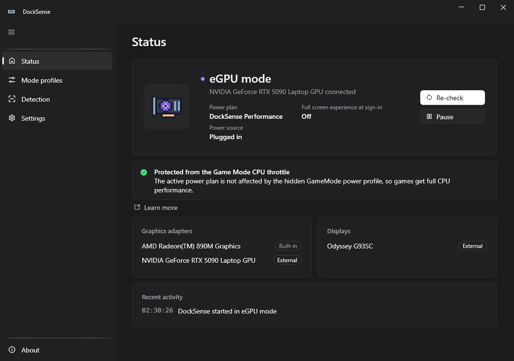
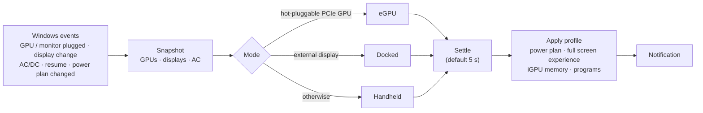
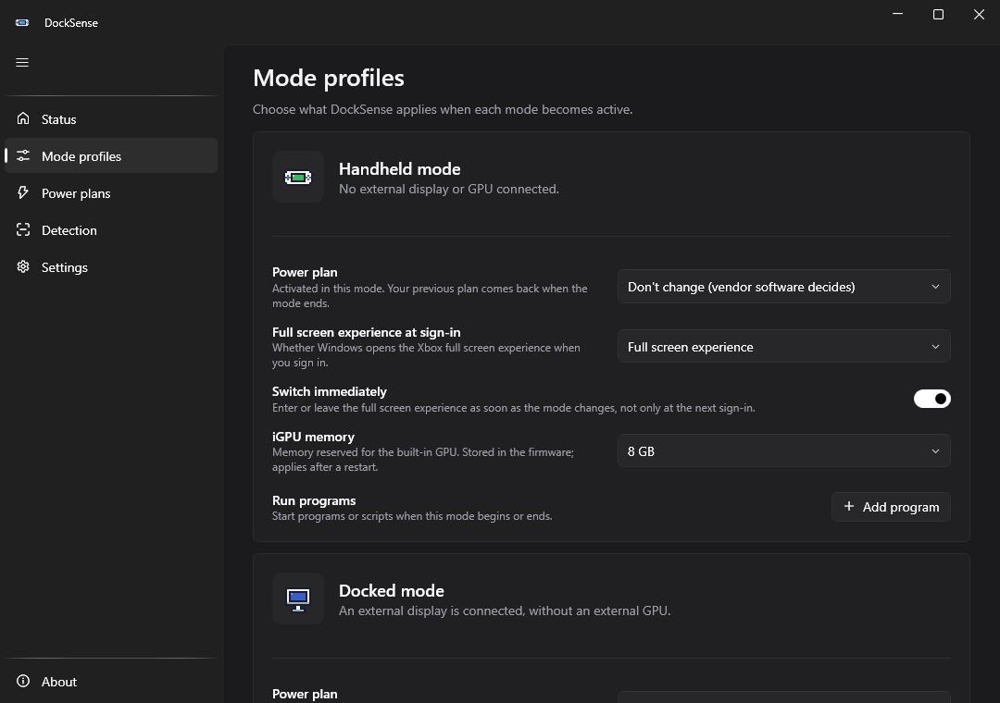
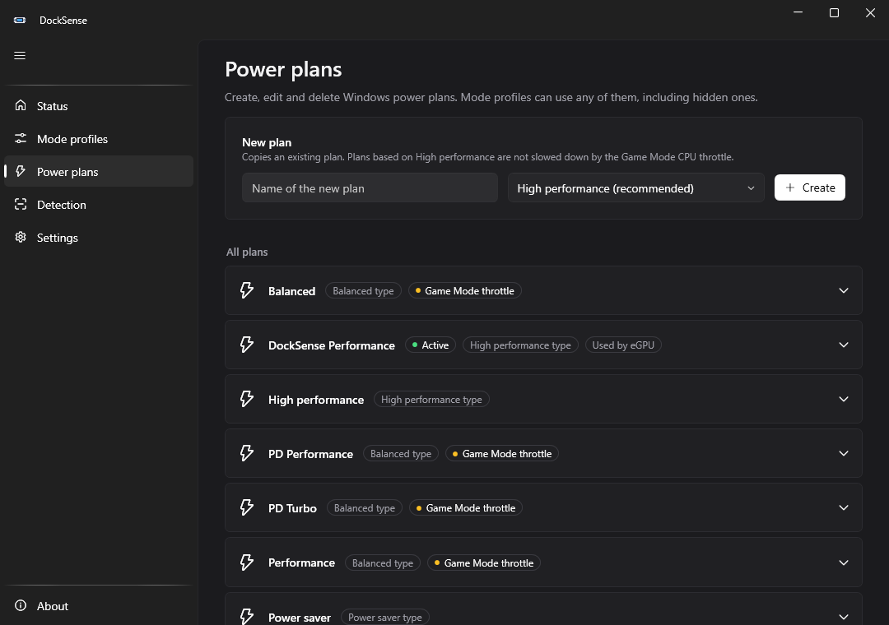
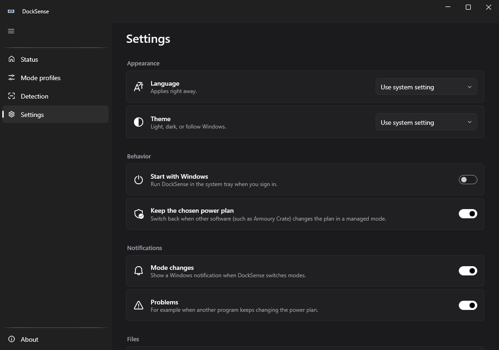
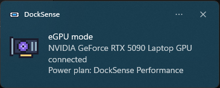

<div align="center">


# DockSense

**The automatic mode switcher for Windows gaming handhelds: Handheld, Docked or eGPU.**

Each mode gets its own power plan, Xbox full screen experience, iGPU memory and programs, applied the moment you dock, undock or plug in an eGPU.

[](https://github.com/rozx/DockSense/actions/workflows/ci.yml)
[](https://github.com/rozx/DockSense/releases)
[](https://github.com/rozx/DockSense/releases)
[](LICENSE)
[](#requirements)
[](https://github.com/rozx/DockSense/stargazers)

**English** · [简体中文](README.zh-CN.md)

[⬇️ Download Latest Release](https://github.com/rozx/DockSense/releases/latest) · [Features](#features) · [How it works](#how-it-works) · [eGPU Throttle Fix](#the-egpu-fix-game-mode-cpu-throttle) · [FAQ](#faq)



</div>

---

DockSense runs quietly in your system tray, watching for external GPUs, external displays and power changes so you never have to switch settings by hand when you dock or undock. It also [fixes low FPS with an eGPU](#the-egpu-fix-game-mode-cpu-throttle), the bug hunt this project started with.

## Features

### Per-mode automation

- 🔌 **Automatic mode detection.** Detects Handheld, Docked (external display) or eGPU (Thunderbolt / USB4 / OCuLink) with debouncing so plugging or unplugging a dock never causes flapping.
- ⚡ **Power plans & built-in editor.** Applies a plan per mode, restores your previous plan on leave, and re-asserts your choice (with backoff) if vendor software such as Armoury Crate changes it back. Includes an eGPU-safe **DockSense Performance** plan and an editor for plugged-in/on-battery settings (including hidden High Performance-type plans).
- 🎮 **Xbox full screen experience.** Sets the sign-in behavior per mode and can switch **immediately** when the mode changes, not only at the next sign-in.
- 🧠 **iGPU memory** *(ASUS handhelds such as the ROG Xbox Ally X; experimental on other AMD handhelds)*. Sets the firmware UMA frame buffer size per mode—for example 8 GB handheld and minimum with an eGPU—and offers **Restart for `<mode>`** in the tray menu so one restart is enough.
- 🔥 **TDP override** *(ROG Ally family; needs the [PawnIO](https://pawnio.eu/) driver)*. Enforces a processor power limit per mode over what Armoury Crate sets—for example 15 W handheld and full power with an eGPU—re-sends it when the vendor software resets it, and hands control back when the mode ends. Values above the manufacturer's maximum come with a clear warning.
- 🚀 **Run programs on mode changes.** Launches apps, scripts or URLs when a mode begins, ends, or starts up, with arguments, a hidden window or administrator rights.

### Built for daily use

- ⏱️ **Starts right at sign-in.** A per-user sign-in task starts DockSense about two seconds after sign-in, ahead of Windows' startup apps—even when booting straight into Xbox full screen experience—so dock changes made while powered off take effect immediately.
- 🔔 **Native notifications & 🩺 Diagnostics.** Toast alerts on mode changes and program launches, a live Game Mode throttle check on the Status page, and a one-click diagnostic report.
- ⬆️ **Self-updating.** Daily GitHub release checks verified with SHA-256 checksums, with one-click or automatic next-start updates (can be turned off).
- 🌐 **English & 简体中文**, light and dark theme, and pixel-art tray icons for every state.
- 🪶 **Lightweight & zero-install.** No admin rights, no driver, no service—just documented Windows APIs plus, for the optional iGPU memory, the ASUS ACPI interface. *(The experimental AMD-driver route for other handhelds uses AMD's own API; whether that needs admin rights is not known yet.)* *(Updating a copy inside a protected folder such as Program Files asks for UAC once per update.)* *(The optional TDP override is the one feature that goes further: it uses the PawnIO driver and asks for administrator approval once.)*

## How it works



| Mode | Detected when | Default profile |
|:---:|---|---|
| <br/>**eGPU** | A PCIe display adapter that Windows reports as hot-pluggable or outside the local machine (Thunderbolt / USB4 docks). OCuLink docks can be marked manually. | DockSense Performance plan · boot to desktop |
| <br/>**Docked** | An active external display, and no eGPU | Plan unchanged · boot to desktop |
| <br/>**Handheld** | Neither of the above | Plan unchanged (vendor decides) · boot into full screen experience |

**Example setup:**

- **Handheld:** vendor TDP/power plan · Xbox full screen experience · 8 GB iGPU memory
- **Docked:** keep power plan · switch to desktop · launch your favorite browser or desktop tools
- **eGPU:** **DockSense Performance** (fixes Game Mode CPU throttle) · desktop · minimum iGPU memory (reclaims RAM for games)

Some details:

- **Vendor IDs are never used.** AMD iGPUs and AMD eGPUs share a vendor. USB display adapters (DisplayLink) and virtual displays (streaming apps) are ignored.
- **Unplugging is messy.** AC power drops about 10 seconds *before* Windows removes the eGPU, and vendor software reacts to the AC change. DockSense keeps the eGPU profile until the GPU is actually gone, then restores the plan your vendor software picked.

## The eGPU fix: Game Mode CPU throttle

DockSense started with one bug hunt: an ASUS ROG Xbox Ally X docked to an RTX 5090 was stuck at ~50 FPS with the CPU throttled to **2 GHz / 12 W**, and only while a game was in the foreground. If your handheld does this with an eGPU, it is the same problem:

- Low FPS or stutter in games, while the graphics card sits far below 100% usage.
- Task Manager shows the CPU at 100%, but it draws only 10–15 W and runs at about 2 GHz.
- Alt-tabbing out of the game makes the CPU speed up at once.
- Armoury Crate reports Turbo at 35 W, yet the CPU never gets there in a game.

Windows **Game Mode** has a hidden processor power profile called `GameMode`. It kicks in while a game has focus. On AMD handhelds, the vendor's provisioning package sets that profile to:

| Setting | Normal | While a game is in the foreground |
|---|---|---|
| Energy performance preference (EPP) | 20 (favor performance) | **100 (maximum power saving)** |
| Thread scheduling | prefer performance cores | **prefer efficient cores** |

That is a sensible choice when the CPU and iGPU share one small power budget. With an **eGPU**, though, the CPU becomes the bottleneck and the expensive graphics card waits half the time. Measured on an ROG Xbox Ally X with an RTX 5090, Game Mode on and the game in the foreground:

| Active power plan | CPU package | CPU clock | Result |
|---|---|---|---|
| Vendor "Turbo" plan (Balanced type) | 10–15 W | 2.2–2.6 GHz | throttled |
| **DockSense Performance** (High Performance type) | **29–45 W** | **4.0–4.4 GHz** | full speed |

The overrides are only provisioned for *Balanced*-type plans, and `powercfg` cannot see them. DockSense switches to a High Performance-based plan while an eGPU is connected, then hands control back to your vendor software when you undock. You can keep Game Mode on.

📖 The full investigation, raw data and registry paths are in **[docs/game-mode-throttle.md](docs/game-mode-throttle.md)**.

## Screenshots

<table>
  <tr>
    <td width="50%"><p align="center"><b>Mode profiles</b>: power plan, full screen experience, iGPU memory and programs per mode</p></td>
    <td width="50%"><p align="center"><b>Power plans</b>: create, edit and delete plans</p></td>
  </tr>
  <tr>
    <td><p align="center"><b>Settings</b>: language, theme, startup, notifications</p></td>
    <td align="center">
      
      <p><b>Notification</b> when the mode changes</p>
      <br />
      &nbsp;
      &nbsp;
      &nbsp;
      
      <p><b>Tray icons</b>: Handheld · Docked · eGPU · Paused</p>
    </td>
  </tr>
</table>

## Installation

### Requirements

- Windows 10 2004 or later, or Windows 11 (x64 or ARM64)
- No .NET installation needed: release builds are self-contained

### Download

1. Download `DockSense-<version>-win-x64.zip` (or `win-arm64.zip` for ARM64) from the **[latest release](https://github.com/rozx/DockSense/releases/latest)**.
2. Extract it anywhere, for example `%LOCALAPPDATA%\Programs\DockSense`, and run **DockSense.exe**.
3. On first launch the window opens. Afterwards DockSense starts quietly in the tray. Turn on **Settings → Start with Windows** to launch it when you sign in. DockSense then starts right at sign-in, through a sign-in task it registers for your account, instead of waiting for Windows to get to its startup apps. This also covers booting straight into the Xbox full screen experience, where Windows normally holds startup apps back until you switch to the desktop.
4. From version 0.3 on, DockSense tells you when a new version is out and can install it for you (**Settings → Updates**). Coming from 0.2.1 or older, replace `DockSense.exe` by hand this one time.

> [!NOTE]
> The executable is not code-signed yet, so Windows SmartScreen may warn on first run (**More info → Run anyway**).

## Usage

- **Tray icon:** left-click opens the window. Right-click lets you pause automatic switching, re-check now, or exit.
- **Status:** the current mode, the active plan, the Game Mode check, detected adapters and displays, and recent activity.
- **Mode profiles:** for each mode, pick:
  - the power plan: *Don't change* (your vendor software decides), *DockSense Performance* (the eGPU-safe plan), or any Windows plan, including hidden ones
  - the full screen experience at sign-in, and whether to **switch immediately** when entering the mode. For example, with Handheld set to the full screen experience and Docked set to the desktop, both switching immediately, docking leaves the full screen experience and undocking enters it again.
  - the **iGPU memory** (on supported ASUS devices, and experimentally on other AMD devices through the AMD graphics driver; applies after a restart), and whether DockSense should **ask before changing** it
  - the **TDP override** (ROG Ally family with the PawnIO driver): switch it on, then drag the slider or type the watts; switched off, the TDP stays with your vendor software
  - **programs to run** when the mode begins or ends. **Test** starts one right away.
- **Power plans:** create a plan from any existing one (High performance-based plans avoid the Game Mode throttle), edit its plugged-in and on-battery settings, rename or delete it.
- **Detection:** settle time, "Docked only when plugged in", and per-adapter overrides (*Always / Never an eGPU*).

Closing the window keeps DockSense running in the tray. Launching DockSense.exe again brings the window back.

## Configuration

Settings are saved to `%APPDATA%\DockSense\config.json`, and the UI edits this file for you. Logs and runtime state live in `%LOCALAPPDATA%\DockSense`.

<details>
<summary><b>All config.json keys and defaults</b></summary>

| Key | Default | Description |
|---|---|---|
| `handheld` / `docked` / `egpu` → `powerPlan.kind` | `Unmanaged` / `Unmanaged` / `DockSensePerformance` | `Unmanaged`, `DockSensePerformance` or `Specific` (with `planId`) |
| `handheld` / `docked` / `egpu` → `fse` | `FullScreenExperience` / `Desktop` / `Desktop` | `Unchanged`, `Desktop` or `FullScreenExperience`, applied at the next sign-in |
| `handheld` / `docked` / `egpu` → `fseApplyImmediately` | `false` | Also enter or leave the full screen experience as soon as the mode changes |
| `handheld` / `docked` / `egpu` → `igpuMemoryMb` | `null` | iGPU memory in MB to store in the firmware (`0` = Auto, `null` = don't change). Applies after a restart |
| `handheld` / `docked` / `egpu` → `igpuMemoryApply` | `Automatic` | `Automatic` stores the size as soon as the mode starts. `Ask` asks in a notification first and stores nothing until you agree |
| `handheld` / `docked` / `egpu` → `tdpWatts` | `null` | Processor power limit in watts to enforce in the mode (`null` = don't change). Supported devices only; values outside the device's range are not sent |
| `tdpConfirmedBoard` / `tdpConfirmedWatts` | `null` / `0` | Written by DockSense when you agree to a TDP above the manufacturer's maximum: the device model it was given for and the highest value, for all mode profiles. A higher value, or any value above the maximum on another model, is not sent until you confirm it in Mode profiles. Copied to another device of the same model, the agreement goes along |
| `handheld` / `docked` / `egpu` → `programs` | `[]` | Programs to start: `path`, `arguments`, `when` (`Enter`, `EnterOrStartup` or `Leave`), `hidden`, `runAsAdministrator`, `enabled` |
| `detection.settleSeconds` | `5` | How long a new mode must stay stable before it is applied |
| `detection.dockedRequiresAcPower` | `false` | Count external displays only while plugged in |
| `detection.forceEgpuInstanceIds` / `ignoreGpuInstanceIds` | `[]` | Per-adapter overrides (PnP instance IDs) |
| `reassertPowerPlan` | `true` | Switch back when other software changes the plan in a managed mode |
| `updates` | `Notify` | `Off` (never check), `Notify` (check once a day and tell you) or `Automatic` (also download, and install the next time DockSense starts) |
| `ui.language` | `system` | `system`, `en` or `zh-Hans` |
| `ui.theme` | `System` | `System`, `Light` or `Dark` |
| `ui.notifyOnStartup` / `ui.notifyOnModeChange` / `ui.notifyOnProgramStart` / `ui.notifyOnWarnings` | `true` | Windows notifications when you start DockSense yourself (not at sign-in), on mode changes, for programs started by a profile, and for problems |

</details>

## Supported hardware

All core features—mode detection, power plans, the Game Mode eGPU throttle fix, Xbox full screen experience and program launching—use standard Windows APIs and work on any Windows handheld (such as ROG Ally / Ally X, Legion Go, MSI Claw, Ayaneo, GPD, OneXPlayer) or laptop. Two optional settings depend on the device. **iGPU memory**:

- **ASUS** handhelds: through the `ATKACPI` firmware interface. Tested.
- **Other AMD handhelds** whose Radeon driver offers *Variable Graphics Memory* (for example the MSI Claw A8): through the AMD driver. 🧪 **Experimental.** It was written from AMD's SDK and has not been run on such a device yet. The driver may restart the PC as soon as a size is stored, so DockSense always asks first and offers the change only together with a restart. If you try it, please [report how it went](https://github.com/rozx/DockSense/issues), problems and successes alike, with the diagnostic report attached.

The **TDP override** covers the ROG Ally family (ROG Ally, ROG Ally X, ROG Xbox Ally X), whose power limits DockSense knows. It has been measured on the ROG Xbox Ally X only; the other models use the same method and are untested.

Tested so far:

| Device | eGPU / dock | Status |
|---|---|---|
| ASUS ROG Xbox Ally X (Ryzen AI Z2 Extreme) | ASUS ROG XG Mobile (RTX 5090 Laptop GPU), USB4 | ✅ Tested: live plug/unplug, Armoury Crate coexistence |

Tested it on another device? Please [open an issue](https://github.com/rozx/DockSense/issues/new) with the output of **About → Copy diagnostic report** so it can be added here.

## FAQ

<details>
<summary><b>I can't find "DockSense Performance" in Control Panel.</b></summary>

On Modern Standby devices, Windows hides High Performance-type plans from Control Panel and `powercfg /list`. The plan exists and works. DockSense's **Power plans** page lists every plan, hidden ones included. You can also check `powercfg /getactivescheme` or the Status page.
</details>

<details>
<summary><b>Why does the iGPU memory need a restart?</b></summary>

The memory reserved for the built-in GPU (the UMA frame buffer) is set by the firmware while the PC starts, the same as in Armoury Crate. DockSense stores the size for the current mode right away. Status then shows the new size as pending, with a **Restart now** button, and the notification has the same button. DockSense never restarts on its own, and it only writes sizes that the firmware itself offers. If you unplug an eGPU and keep playing without restarting, the old size stays in effect until the next restart. Most games run fine either way, because Windows also lends the iGPU shared memory.

To skip the "unplug, wait, then restart" order, use the tray menu before you switch: **Restart for Handheld (8 GB)** (the entry names the mode and its size) stores that mode's size and restarts Windows after you confirm. Plug in or unplug the dock or eGPU while the PC restarts, and it comes up with the right memory already in effect. The entry only appears when another mode's size differs from the one in effect.

If you would rather decide each time, turn on **Ask before changing the iGPU memory** in a mode's profile. When that mode starts, a notification asks first, with **Change** and **Change and restart**. Nothing is stored in the firmware until you pick one, and the Status page keeps the question open if you miss the notification.

On devices without the ASUS interface, DockSense sets the size through the AMD graphics driver (Variable Graphics Memory) when the driver offers it. This is **experimental**: the driver may restart the PC by itself when a size is stored, so every change is asked first and comes as **Change and restart**. Please [report issues on GitHub](https://github.com/rozx/DockSense/issues).

Some PCs do not start with an eGPU attached. On those, use **Restart for eGPU** while the eGPU is unplugged and connect it after you sign in. DockSense keeps the eGPU size for a few minutes after that restart instead of putting the handheld size back.
</details>

<details>
<summary><b>How does the TDP override work, and is it safe?</b></summary>

Each mode can enforce its own processor power limit (TDP), whatever Armoury Crate is set to: for example 15 W as a handheld for battery life, and switched off with an eGPU.

- **What it needs.** The [PawnIO](https://pawnio.eu/) driver, which you install yourself (DockSense does not ship or install a driver), an administrator account, and DockSense installed in a folder of its own under Program Files. Copy it there with administrator approval (copying, not moving, so that the files get the folder's permissions), quit the old copy from the tray and start the new one. If **Start with Windows** was on, turn it on again in the new copy (**Settings → Start with Windows**): the sign-in entry still points to the old one.
- **Why a driver.** On the ROG Xbox Ally X the firmware accepts power limits through ASUS's own interface and then ignores them. DockSense therefore sends the limit to the processor directly, the way RyzenAdj, Universal x86 Tuning Utility, G-Helper and Handheld Companion do, and that takes a driver. PawnIO is signed and only runs modules signed by its author; DockSense includes the unchanged AMD module from the PawnIO project.
- **Why administrator approval.** PawnIO only talks to administrators. The first time you choose a value, Windows asks once and DockSense registers a task (`DockSense-TDP-<your user ID>` in Task Scheduler) that sets the TDP with administrator rights. DockSense itself keeps running without them. The task takes nothing but a watt value and checks it against the device's range itself. This is also why the folder matters: the task runs `DockSense.exe`, so in a folder any program can write to, that file could be replaced. **Settings → TDP helper → Remove** takes the task away again.
- **What it sets.** DockSense requests the same ceiling for the sustained, medium and short-term limits. It is a ceiling, not a target: while those limits are in force the processor draws less at idle or under a light load, and for the few seconds after the vendor software has replaced them (see *Staying in force*) it can draw more. The range runs from the manufacturer's minimum (7 W on the Ally family) up to the highest short-burst limit the firmware itself uses (55 W on the ROG Xbox Ally X, less on battery for the older models).
- **Above the manufacturer's maximum.** For a value above what the manufacturer allows (35 W on the ROG Xbox Ally X), DockSense asks before it accepts it and keeps a warning under the setting. Running above that limit can overheat the device, wear out the battery and damage the hardware, and the warranty may not cover it. You do this at your own risk. It may also gain you little: on the ROG Xbox Ally X, a 45 W setting ran the processor at 44 W for about a minute, then the firmware pulled it back to 35 W once it was hot (93 °C) and held it there, the same as Armoury Crate's Turbo does. Other devices may behave differently.
- **Staying in force.** The firmware loads its own limits again whenever the vendor software sends a performance mode, which happens when you plug in or unplug the charger, after sleep, and when you switch modes in Armoury Crate. DockSense sends its value again a few seconds after each of these.
- **Giving it back.** When a mode with the override switched off begins, DockSense re-sends the performance mode Armoury Crate has selected, and the firmware goes back to that mode's own limits. Only Silent, Performance and Turbo can be re-sent this way. If Armoury Crate is on another mode, such as *Manual*, DockSense sends Turbo when plugged in and Performance on battery instead, and you get your own values back by selecting the mode in Armoury Crate again. A restart of the PC also clears every limit.
</details>

<details>
<summary><b>Switching the full screen experience right away doesn't work.</b></summary>

It needs a Windows build with the full screen experience (Windows 11 on a handheld, or with "Xbox mode" enabled) and a home app (the Xbox app, or a launcher such as AnyFSE). If Windows asks for confirmation, choose to start without restarting. When Windows is set to *Restart to optimize* on entering, DockSense won't switch live, because that would restart the PC; the setting still applies at the next sign-in.
</details>

<details>
<summary><b>Will DockSense fight with Armoury Crate / Legion Space / other vendor tools?</b></summary>

Only in modes where you chose a specific plan, and only within limits. If something switches the plan more than 5 times in 2 minutes, DockSense stops re-applying it until the next mode change and tells you. Vendor TDP settings (e.g. Armoury Crate's 35 W Turbo) are separate from Windows plans and keep working, unless you give the mode a TDP override of its own.
</details>

<details>
<summary><b>Do I need to turn off Game Mode?</b></summary>

No. That was the old workaround. With an eGPU connected, DockSense uses a plan that the Game Mode profile doesn't touch, so Game Mode can stay on, and it keeps helping handheld play.
</details>

<details>
<summary><b>"Start with Windows" is on, but DockSense doesn't start.</b></summary>

Open **Settings**: the switch shows what really happens at sign-in, and a note under it says what is in the way.

- **Windows switched it off.** Task Manager and Windows Settings → Apps → Startup can disable a startup app without DockSense being asked. The switch then shows off; turn it on in DockSense to enable it again.
- **Another copy starts.** If you moved DockSense, the startup entry still points at the old place. Turn the switch on in the copy you want.
- **Windows waits for the desktop.** When Windows boots into the Xbox full screen experience, it holds startup apps back until you first switch to the desktop, unless the app is set to *Start at log in*. DockSense sets that for itself. If it was changed, turn the switch off and on again.
- **It starts, but late.** DockSense normally starts about two seconds after sign-in, from a task named `DockSense-<your user ID>` in Task Scheduler. Windows' own startup entry is the fallback, and Windows only runs it half a minute to more than a minute after sign-in. If the task is missing or disabled, Settings says so; turn the switch off and on again to register it.
</details>

<details>
<summary><b>I switched the PC on docked, and it still came up in the full screen experience (or the other way round).</b></summary>

Windows decides whether to boot into the full screen experience once, when its shell starts, from the setting DockSense stored for the mode you were in last. DockSense starts ahead of the shell and corrects the setting for the mode the PC is in now. If Windows read it first anyway, DockSense switches about 20 seconds after sign-in, provided the mode's profile has **switch immediately** on. This needs **Start with Windows** to be on.

If you know which mode comes next, **Restart for Handheld** (or Docked, or eGPU) in the tray menu stores that mode's setting before the restart.
</details>

<details>
<summary><b>How do updates work, and what does DockSense send?</b></summary>

Once a day DockSense asks GitHub for the latest release of this repository (a check that fails, for example offline, is tried again a few hours later). The request carries nothing but the DockSense version in the user agent. Choose under **Settings → Updates**:

- **Tell me** (default): a notification and a card on the Status page. **Install update** downloads the release, checks it and restarts DockSense. Your mode and power plan stay as they are, and no profile programs run again.
- **Install automatically**: the release is downloaded in the background and goes in the next time DockSense starts, so it never restarts in the middle of a game.
- **Don't check**: no requests at all. **Check now** still works.

The zip is only taken from this repository's releases, and its size and SHA-256 must match what GitHub publishes for the release. DockSense is a single file: it exits, the downloaded version renames the old `DockSense.exe` to `DockSense.exe.old`, takes its place and starts. The old file is removed at the next start.

If DockSense sits in a folder you cannot write to, such as Program Files, Windows asks for administrator approval for the file swap, and automatic updates wait for your click. The approved step checks the zip against GitHub once more by itself before it touches anything, and there Windows removes the old file at the next restart of the PC.

The builds are not code-signed yet, so the checksum shows that the download is the file on GitHub, not who built it.
</details>

<details>
<summary><b>How do I uninstall DockSense completely?</b></summary>

1. Optionally delete the DockSense Performance plan on the **Power plans** page while it isn't active (Windows can't delete the active plan). `powercfg /delete <guid>` works too; the GUID is `dockSensePerformancePlanId` in `config.json`.
2. Turn off **Start with Windows** (this also removes the sign-in task). If you used the TDP override, remove the helper task with **Settings → TDP helper → Remove**. Then exit from the tray.
3. Delete the DockSense folder, plus `%APPDATA%\DockSense` and `%LOCALAPPDATA%\DockSense`.
</details>

<details>
<summary><b>Something switched the wrong way. How do I debug it?</b></summary>

Open **Settings → Open log**. Every decision is logged with the hardware snapshot behind it. Running `DockSense.exe --probe report.txt` writes a read-only diagnostic report: the device and its firmware, how each graphics adapter is connected, the displays, power plans, the vendor interfaces and vendor software found, and your DockSense settings. It leaves out your user name, the computer name and the programs your profiles start.
</details>

## Building from source

Requires Windows and the [.NET 10 SDK](https://dotnet.microsoft.com/download).

```powershell
git clone https://github.com/rozx/DockSense.git
cd DockSense
dotnet build
dotnet test
dotnet run --project src/DockSense.App
```

| Project | Purpose |
|---|---|
| `src/DockSense.Core` | Platform-independent logic: mode resolution, debouncing, power plan policy, program triggers, power setting catalog, iGPU memory decoding, config (fully unit tested) |
| `src/DockSense.App` | WPF tray app: Windows APIs (SetupAPI, display config, powrprof, gaming experience), ASUS ACPI, the TDP override (PawnIO), UI, notifications |
| `tests/DockSense.Core.Tests` | xUnit tests, including the measured Ally X / XG Mobile unplug sequence |
| `tools/DockSense.IconGen` | Generates every icon from the pixel-art grids in `Sprites.cs` |

The icons are text. To change one, edit `tools/DockSense.IconGen/Sprites.cs` and run `dotnet run --project tools/DockSense.IconGen -- assets`.

<details>
<summary><b>Release process (maintainers)</b></summary>

Releases are automated, but they only happen when **all three** of these are true:

1. A pull request into `main` is **merged**.
2. Its branch is named **`release/v<major>.<minor>`** or `release/v<major>.<minor>.<patch>`, for example `release/v0.2` or `release/v1.2.3`.
3. The pull request has the **`release`** label.

GitHub Actions then reads the version from the branch name, runs the tests, builds self-contained single-file executables for x64 and ARM64, tags the merge commit `v<version>`, and publishes the release. Its description is the version's section of [CHANGELOG.md](CHANGELOG.md), followed by GitHub's list of merged pull requests. CI fails on a release PR whose version has no CHANGELOG section. Every other push or pull request only runs CI (build + tests).

</details>

## Contributing

Bug reports, device reports and pull requests are welcome. If DockSense is useful to you, a ⭐ helps other handheld owners find it.

- Please include the diagnostic report (**About → Copy diagnostic report**) with hardware-related issues.
- Keep `DockSense.Core` free of Windows APIs, and add tests for new decision logic.
- UI text lives in `src/DockSense.App/Localization/Strings*.resx`. Please update both English and Chinese.

## Acknowledgements

- [WPF-UI](https://github.com/lepoco/wpfui): Fluent controls for WPF
- [H.NotifyIcon](https://github.com/HavenDV/H.NotifyIcon): tray icon
- [CommunityToolkit.Mvvm](https://github.com/CommunityToolkit/dotnet) and the [Windows Community Toolkit](https://github.com/CommunityToolkit/WindowsCommunityToolkit) notifications
- [PawnIO](https://pawnio.eu/) and its [modules](https://github.com/namazso/PawnIO.Modules) by namazso (the AMD SMU module is included unchanged, LGPL-2.1), for the TDP override
- [RyzenAdj](https://github.com/FlyGoat/RyzenAdj), [Universal x86 Tuning Utility](https://github.com/JamesCJ60/Universal-x86-Tuning-Utility) and [G-Helper](https://github.com/seerge/g-helper) for how the processor's power limits are set, and the Linux `asus-armoury` driver for the Ally family's limits
- [Sweetie 16](https://lospec.com/palette-list/sweetie-16) palette by GrafxKid, used for the pixel-art icons

## License

DockSense is free software, released under the [GNU General Public License v3.0](LICENSE).
Copyright © 2026 [rozx](https://github.com/rozx).
