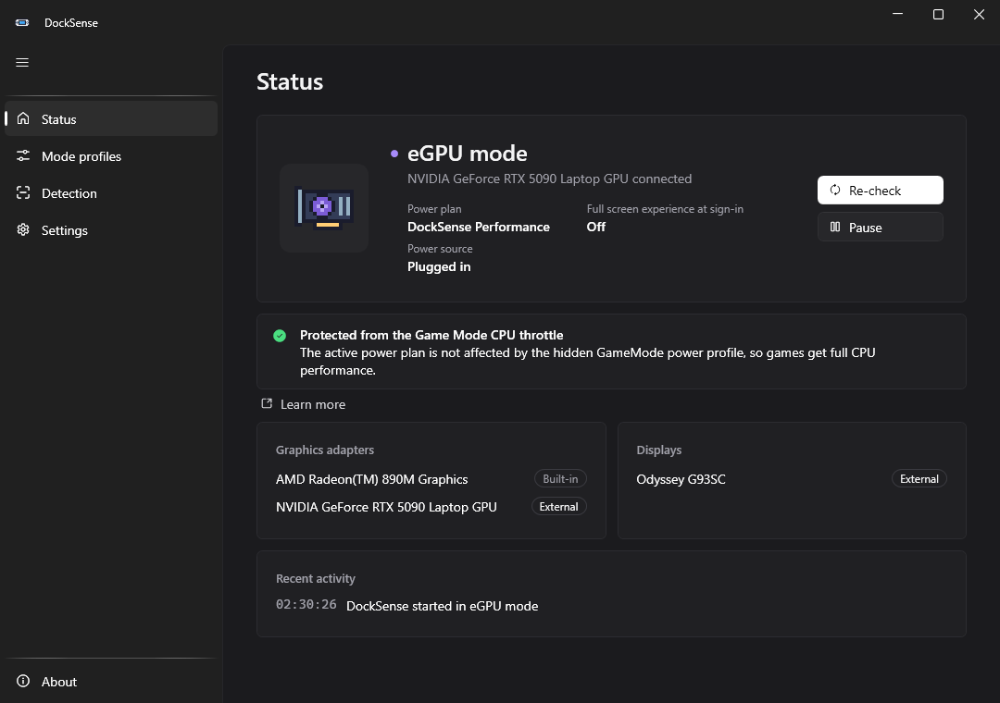
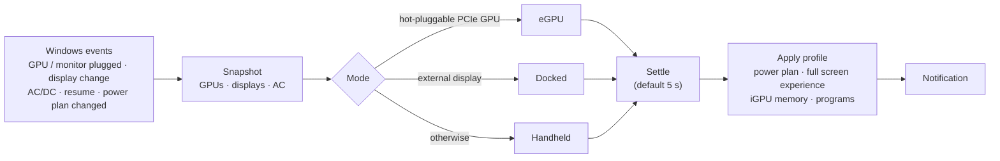
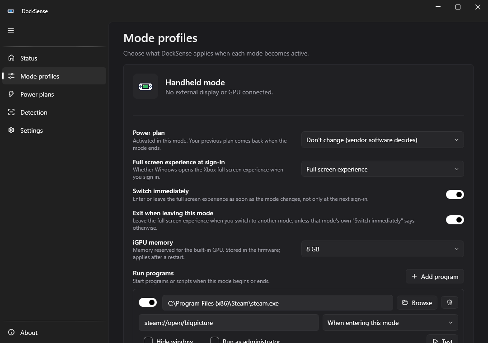
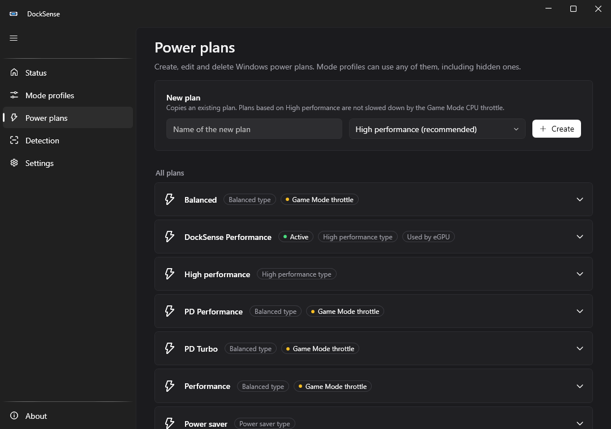
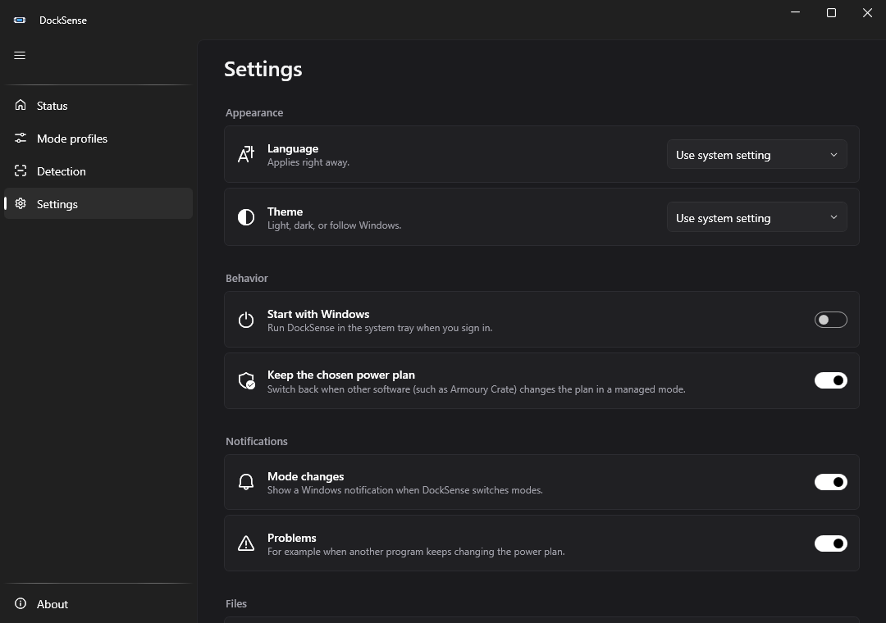
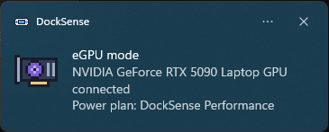

<div align="center">


# DockSense

**Automatic power profiles for Windows gaming handhelds: Handheld, Docked or eGPU.**

[](https://github.com/rozx/DockSense/actions/workflows/ci.yml)
[](https://github.com/rozx/DockSense/releases)
[](https://github.com/rozx/DockSense/releases)
[](LICENSE)
[](#requirements)
[](https://dotnet.microsoft.com/)
[](https://github.com/rozx/DockSense/stargazers)

**English** · [简体中文](README.zh-CN.md)



</div>

---

DockSense lives in your system tray. It watches for external GPUs, external displays and power changes, and works out how your handheld is being used. Then it applies the matching **power plan** and **Xbox full screen experience**, sets the **iGPU memory** and starts **your own programs**. You don't have to switch anything by hand when you dock or undock.

It started with one bug hunt: an ASUS ROG Xbox Ally X docked to an RTX 5090 was stuck at ~50 FPS with the CPU throttled to **2 GHz / 12 W**, and only while a game was in the foreground.

## Contents

- [Why DockSense](#why-docksense)
- [Features](#features)
- [How it works](#how-it-works)
- [Screenshots](#screenshots)
- [Installation](#installation)
- [Usage](#usage)
- [Configuration](#configuration)
- [Supported hardware](#supported-hardware)
- [FAQ](#faq)
- [Building from source](#building-from-source)
- [Roadmap](#roadmap)
- [Contributing](#contributing)
- [Acknowledgements](#acknowledgements)
- [License](#license)

## Why DockSense

Windows **Game Mode** has a hidden processor power profile called `GameMode`. It kicks in while a game has focus. On AMD handhelds, the vendor's provisioning package sets that profile to:

| Setting | Normal | While a game is in the foreground |
|---|---|---|
| Energy performance preference (EPP) | 20 (favor performance) | **100 (maximum power saving)** |
| Thread scheduling | prefer performance cores | **prefer efficient cores** |

That is a sensible choice when the CPU and iGPU share one small power budget. With an **eGPU**, though, the CPU becomes the bottleneck and the expensive graphics card waits half the time. Measured on a ROG Xbox Ally X with an RTX 5090, Game Mode on and the game in the foreground:

| Active power plan | CPU package | CPU clock | Result |
|---|---|---|---|
| Vendor "Turbo" plan (Balanced type) | 10–15 W | 2.2–2.6 GHz | throttled |
| **DockSense Performance** (High Performance type) | **29–45 W** | **4.0–4.4 GHz** | full speed |

The overrides are only provisioned for *Balanced*-type plans, and `powercfg` cannot see them. DockSense switches to a High Performance-based plan while an eGPU is connected, then hands control back to your vendor software when you undock. You can keep Game Mode on.

📖 The full investigation, raw data and registry paths are in **[docs/game-mode-throttle.md](docs/game-mode-throttle.md)**.

## Features

- 🔌 **Automatic mode detection.** Handheld, Docked (external display) or eGPU (Thunderbolt / USB4 / OCuLink), with debouncing so a dock being plugged in or out never causes flapping.
- ⚡ **Per-mode power plans.** DockSense restores your previous plan when a mode ends, and creates an "eGPU-safe" plan that is immune to the Game Mode throttle.
- 🛡️ **Keeps the plan you chose.** If vendor software (e.g. Armoury Crate) switches the plan back, DockSense re-applies it, and it backs off if something keeps fighting.
- 🛠️ **Power plan editor.** Create plans from any existing plan, edit the settings that matter on a handheld (processor state, EPP, boost mode, max frequency, core preference, display and sleep timeouts) for plugged-in and on-battery use, and rename or delete plans. Hidden High Performance-type plans are listed too.
- 🎮 **Xbox full screen experience per mode.** For example, use the full screen experience as a handheld and the desktop when docked. DockSense can switch it **right away** when the mode changes, not only at the next sign-in.
- 🚀 **Run programs on mode changes.** Start a program, script or URL when a mode begins or ends (or when DockSense starts in it), with arguments, a hidden window or administrator rights.
- 🧠 **iGPU memory per mode** (ASUS handhelds such as the ROG Xbox Ally X). For example, give the built-in GPU 8 GB as a handheld and the minimum with an eGPU, so games get that RAM back. The firmware applies it at the next restart, and DockSense tells you when one is needed.
- 🔔 **Native Windows notifications** when the mode changes (showing the detected GPU and the plan that was applied), when a profile starts a program, and when you start DockSense yourself, so you know it is running in the background.
- 🩺 **Diagnostics.** The status page shows whether the Game Mode throttle affects your current plan. A one-click report lists adapters, displays, plans and hidden overrides.
- ⬆️ **Updates itself.** DockSense tells you when a new release is out and installs it with one click, or by itself the next time it starts. The download comes from the GitHub release and is checked against the release's SHA-256 checksum. You can turn the daily check off.
- 🌐 **English and 简体中文**, light and dark theme, and pixel-art tray icons for every state.
- 🪶 **No admin rights, no driver, no service.** It uses documented Windows APIs, plus the ASUS ACPI interface (the one Armoury Crate uses) for the optional iGPU memory setting. The one exception: updating a copy that sits in a protected folder such as Program Files asks for administrator approval once per update.

## How it works



| Mode | Detected when | Default profile |
|:---:|---|---|
| <br/>**eGPU** | A PCIe display adapter that Windows reports as hot-pluggable or outside the local machine (Thunderbolt / USB4 docks). OCuLink docks can be marked manually. | DockSense Performance plan · boot to desktop |
| <br/>**Docked** | An active external display, and no eGPU | Plan unchanged · boot to desktop |
| <br/>**Handheld** | Neither of the above | Plan unchanged (vendor decides) · boot into full screen experience |

Some details:

- **Vendor IDs are never used.** AMD iGPUs and AMD eGPUs share a vendor. USB display adapters (DisplayLink) and virtual displays (streaming apps) are ignored.
- **Unplugging is messy.** AC power drops about 10 seconds *before* Windows removes the eGPU, and vendor software reacts to the AC change. DockSense keeps the eGPU profile until the GPU is actually gone, then restores the plan your vendor software picked.

## Screenshots

<table>
  <tr>
    <td width="50%"><p align="center"><b>Mode profiles</b>: power plan, full screen experience, iGPU memory and programs per mode</p></td>
    <td width="50%"><p align="center"><b>Power plans</b>: create, edit and delete plans</p></td>
  </tr>
  <tr>
    <td><p align="center"><b>Settings</b>: language, theme, startup, notifications</p></td>
    <td></td>
  </tr>
  <tr>
    <td><p align="center"><b>Notification</b> when the mode changes</p></td>
    <td align="center">
      &nbsp;
      &nbsp;
      &nbsp;
      
      <p><b>Tray icons</b>: Handheld · Docked · eGPU · Paused</p>
    </td>
  </tr>
</table>

## Installation

### Requirements

- Windows 10 2004 or later, or Windows 11 (x64 or ARM64)
- No .NET installation needed: release builds are self-contained

### Download

1. Download `DockSense-<version>-win-x64.zip` from the **[latest release](https://github.com/rozx/DockSense/releases/latest)**.
2. Extract it anywhere, for example `%LOCALAPPDATA%\Programs\DockSense`, and run **DockSense.exe**.
3. On first launch the window opens. Afterwards DockSense starts quietly in the tray. Turn on **Settings → Start with Windows** to launch it when you sign in. This also covers booting straight into the Xbox full screen experience, where Windows normally holds startup apps back until you switch to the desktop.

> [!NOTE]
> The executable is not code-signed yet, so Windows SmartScreen may warn on first run (**More info → Run anyway**).

## Usage

- **Tray icon:** left-click opens the window. Right-click lets you pause automatic switching, re-check now, or exit.
- **Status:** the current mode, the active plan, the Game Mode check, detected adapters and displays, and recent activity.
- **Mode profiles:** for each mode, pick:
  - the power plan: *Don't change* (your vendor software decides), *DockSense Performance* (the eGPU-safe plan), or any Windows plan, including hidden ones
  - the full screen experience at sign-in, whether to **switch immediately** when entering the mode, and whether to **exit when leaving** it. The mode you enter decides first. For example, with *Exit when leaving* on for Handheld, docking leaves the full screen experience unless the Docked profile switches it itself.
  - the **iGPU memory** (on supported ASUS devices; applies after a restart)
  - **programs to run** when the mode begins or ends. **Test** starts one right away.
- **Power plans:** create a plan from any existing one (High performance-based plans avoid the Game Mode throttle), edit its plugged-in and on-battery settings, rename or delete it.
- **Detection:** settle time, "Docked only when plugged in", and per-adapter overrides (*Always / Never an eGPU*).

Closing the window keeps DockSense running in the tray. Launching DockSense.exe again brings the window back.

## Configuration

Settings are saved to `%APPDATA%\DockSense\config.json`, and the UI edits this file for you. Logs and runtime state live in `%LOCALAPPDATA%\DockSense`.

| Key | Default | Description |
|---|---|---|
| `handheld` / `docked` / `egpu` → `powerPlan.kind` | `Unmanaged` / `Unmanaged` / `DockSensePerformance` | `Unmanaged`, `DockSensePerformance` or `Specific` (with `planId`) |
| `handheld` / `docked` / `egpu` → `fse` | `FullScreenExperience` / `Desktop` / `Desktop` | `Unchanged`, `Desktop` or `FullScreenExperience`, applied at the next sign-in |
| `handheld` / `docked` / `egpu` → `fseApplyImmediately` | `false` | Also enter or leave the full screen experience as soon as the mode changes |
| `handheld` / `docked` / `egpu` → `fseExitOnLeave` | `false` | Leave the full screen experience when switching away from this mode, unless the new mode's `fseApplyImmediately` decides otherwise |
| `handheld` / `docked` / `egpu` → `igpuMemoryMb` | `null` | iGPU memory in MB to store in the firmware (`0` = Auto, `null` = don't change). Applies after a restart |
| `handheld` / `docked` / `egpu` → `programs` | `[]` | Programs to start: `path`, `arguments`, `when` (`Enter`, `EnterOrStartup` or `Leave`), `hidden`, `runAsAdministrator`, `enabled` |
| `detection.settleSeconds` | `5` | How long a new mode must stay stable before it is applied |
| `detection.dockedRequiresAcPower` | `false` | Count external displays only while plugged in |
| `detection.forceEgpuInstanceIds` / `ignoreGpuInstanceIds` | `[]` | Per-adapter overrides (PnP instance IDs) |
| `reassertPowerPlan` | `true` | Switch back when other software changes the plan in a managed mode |
| `updates` | `Notify` | `Off` (never check), `Notify` (check once a day and tell you) or `Automatic` (also download, and install the next time DockSense starts) |
| `ui.language` | `system` | `system`, `en` or `zh-Hans` |
| `ui.theme` | `System` | `System`, `Light` or `Dark` |
| `ui.notifyOnStartup` / `ui.notifyOnModeChange` / `ui.notifyOnProgramStart` / `ui.notifyOnWarnings` | `true` | Windows notifications when you start DockSense yourself (not at sign-in), on mode changes, for programs started by a profile, and for problems |

## Supported hardware

DockSense uses standard Windows APIs, so it should work on any Windows handheld or laptop. Tested so far:

| Device | eGPU / dock | Status |
|---|---|---|
| ASUS ROG Xbox Ally X (Ryzen AI Z2 Extreme) | ASUS ROG XG Mobile (RTX 5090 Laptop GPU), USB4 | ✅ Tested: live plug/unplug, Armoury Crate coexistence |

Tested it on another device? Please [open an issue](https://github.com/rozx/DockSense/issues/new) with the output of **About → Copy diagnostic report** so it can be added here.

## FAQ

<details>
<summary><b>I can't find "DockSense Performance" in Control Panel.</b></summary>

On Modern Standby devices, Windows hides High Performance-type plans from Control Panel and `powercfg /list`. The plan exists and works. DockSense's **Power plans** page lists every plan, hidden ones included. You can also check `powercfg /getactivescheme` or the Status page.
</details>

<details>
<summary><b>Why does the iGPU memory need a restart?</b></summary>

The memory reserved for the built-in GPU (the UMA frame buffer) is set by the firmware while the PC starts, the same as in Armoury Crate. DockSense stores the size for the current mode right away. Status then shows the new size as pending, with a **Restart now** button. DockSense never restarts on its own, and it only writes sizes that the firmware itself offers. If you unplug an eGPU and keep playing without restarting, the old size stays in effect until the next restart. Most games run fine either way, because Windows also lends the iGPU shared memory.
</details>

<details>
<summary><b>Switching the full screen experience right away doesn't work.</b></summary>

It needs a Windows build with the full screen experience (Windows 11 on a handheld, or with "Xbox mode" enabled) and a home app (the Xbox app, or a launcher such as AnyFSE). If Windows asks for confirmation, choose to start without restarting. When Windows is set to *Restart to optimize* on entering, DockSense won't switch live, because that would restart the PC; the setting still applies at the next sign-in.
</details>

<details>
<summary><b>Will DockSense fight with Armoury Crate / Legion Space / other vendor tools?</b></summary>

Only in modes where you chose a specific plan, and only within limits. If something switches the plan more than 5 times in 2 minutes, DockSense stops re-applying it until the next mode change and tells you. Vendor TDP settings (e.g. Armoury Crate's 35 W Turbo) are separate from Windows plans and keep working.
</details>

<details>
<summary><b>Do I need to turn off Game Mode?</b></summary>

No. That was the old workaround. With an eGPU connected, DockSense uses a plan that the Game Mode profile doesn't touch, so Game Mode can stay on, and it keeps helping handheld play.
</details>

<details>
<summary><b>"Start with Windows" is on, but DockSense doesn't start.</b></summary>

Open **Settings**: the switch shows what really happens at sign-in, and a note under it says what is in the way.

- **Windows switched it off.** Task Manager and Windows Settings → Apps → Startup can disable a startup app without DockSense being asked. The switch then shows off; turn it on in DockSense to enable it again.
- **Another copy starts.** If you moved DockSense, the startup entry still points at the old place. Turn the switch on in the copy you want.
- **Windows waits for the desktop.** When Windows boots into the Xbox full screen experience, it holds startup apps back until you first switch to the desktop, unless the app is set to *Start at log in*. DockSense sets that for itself. If it was changed, turn the switch off and on again.
</details>

<details>
<summary><b>How do updates work, and what does DockSense send?</b></summary>

Once a day DockSense asks GitHub for the latest release of this repository (a check that fails, for example offline, is tried again a few hours later). The request carries nothing but the DockSense version in the user agent. Choose under **Settings → Updates**:

- **Tell me** (default): a notification and a card on the Status page. **Install update** downloads the release, checks it and restarts DockSense. Your mode and power plan stay as they are, and no profile programs run again.
- **Install automatically**: the release is downloaded in the background and goes in the next time DockSense starts, so it never restarts in the middle of a game.
- **Don't check**: no requests at all. **Check now** still works.

The zip is only taken from this repository's releases, and its size and SHA-256 must match what GitHub publishes for the release. DockSense is a single file: it exits, the downloaded version renames the old `DockSense.exe` to `DockSense.exe.old`, takes its place and starts. The old file is removed at the next start.

If DockSense sits in a folder you cannot write to, such as Program Files, Windows asks for administrator approval for the file swap, and automatic updates wait for your click. The approved step checks the zip against GitHub once more by itself before it touches anything, and there Windows removes the old file at the next restart of the PC.

The builds are not code-signed yet, so the checksum shows that the download is the file on GitHub, not who built it.
</details>

<details>
<summary><b>How do I uninstall DockSense completely?</b></summary>

1. Optionally delete the DockSense Performance plan on the **Power plans** page while it isn't active (Windows can't delete the active plan). `powercfg /delete <guid>` works too; the GUID is `dockSensePerformancePlanId` in `config.json`.
2. Turn off **Start with Windows**, then exit from the tray.
3. Delete the DockSense folder, plus `%APPDATA%\DockSense` and `%LOCALAPPDATA%\DockSense`.
</details>

<details>
<summary><b>Something switched the wrong way. How do I debug it?</b></summary>

Open **Settings → Open log**. Every decision is logged with the hardware snapshot behind it. Running `DockSense.exe --probe report.txt` writes a read-only diagnostic report.
</details>

## Building from source

Requires Windows and the [.NET 10 SDK](https://dotnet.microsoft.com/download).

```powershell
git clone https://github.com/rozx/DockSense.git
cd DockSense
dotnet build
dotnet test
dotnet run --project src/DockSense.App
```

| Project | Purpose |
|---|---|
| `src/DockSense.Core` | Platform-independent logic: mode resolution, debouncing, power plan policy, program triggers, power setting catalog, iGPU memory decoding, config (fully unit tested) |
| `src/DockSense.App` | WPF tray app: Windows APIs (SetupAPI, display config, powrprof, gaming experience), ASUS ACPI, UI, notifications |
| `tests/DockSense.Core.Tests` | xUnit tests, including the measured Ally X / XG Mobile unplug sequence |
| `tools/DockSense.IconGen` | Generates every icon from the pixel-art grids in `Sprites.cs` |

The icons are text. To change one, edit `tools/DockSense.IconGen/Sprites.cs` and run `dotnet run --project tools/DockSense.IconGen -- assets`.

### Release process

Releases are automated, but they only happen when **all three** of these are true:

1. A pull request into `main` is **merged**.
2. Its branch is named **`release/v<major>.<minor>`** or `release/v<major>.<minor>.<patch>`, for example `release/v0.2` or `release/v1.2.3`.
3. The pull request has the **`release`** label.

GitHub Actions then reads the version from the branch name, runs the tests, builds self-contained single-file executables for x64 and ARM64, tags the merge commit `v<version>`, and publishes the release. Its description is the version's section of [CHANGELOG.md](CHANGELOG.md), followed by GitHub's list of merged pull requests. CI fails on a release PR whose version has no CHANGELOG section. Every other push or pull request only runs CI (build + tests).

## Roadmap

- [x] Switch the full screen experience live when the mode changes, not only at sign-in (v0.2)
- [x] Power plan editor (v0.2)
- [x] Run programs on mode changes (v0.2)
- [x] iGPU memory per mode on ASUS handhelds (v0.2)
- [x] In-app updates (v0.3)
- [ ] Per-mode TDP via vendor interfaces (ASUS, Lenovo, ...)
- [ ] iGPU memory on other vendors' handhelds
- [ ] Per-game profiles
- [ ] winget / Microsoft Store distribution
- [ ] Code signing

Ideas and votes are welcome in [Issues](https://github.com/rozx/DockSense/issues).

## Contributing

Bug reports, device reports and pull requests are welcome.

- Please include the diagnostic report (**About → Copy diagnostic report**) with hardware-related issues.
- Keep `DockSense.Core` free of Windows APIs, and add tests for new decision logic.
- UI text lives in `src/DockSense.App/Localization/Strings*.resx`. Please update both English and Chinese.

## Acknowledgements

- [WPF-UI](https://github.com/lepoco/wpfui): Fluent controls for WPF
- [H.NotifyIcon](https://github.com/HavenDV/H.NotifyIcon): tray icon
- [CommunityToolkit.Mvvm](https://github.com/CommunityToolkit/dotnet) and the [Windows Community Toolkit](https://github.com/CommunityToolkit/WindowsCommunityToolkit) notifications
- [Sweetie 16](https://lospec.com/palette-list/sweetie-16) palette by GrafxKid, used for the pixel-art icons

## License

DockSense is free software, released under the [GNU General Public License v3.0](LICENSE).
Copyright © 2026 [rozx](https://github.com/rozx).
