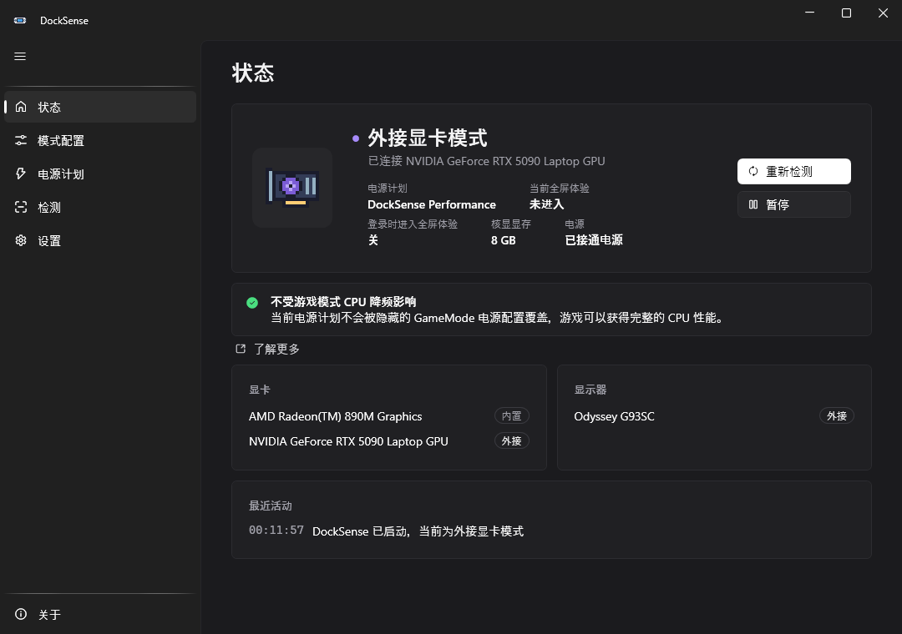
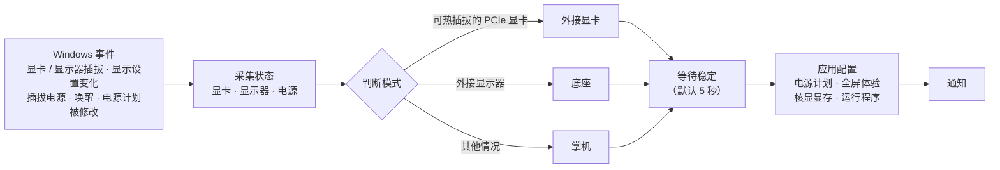
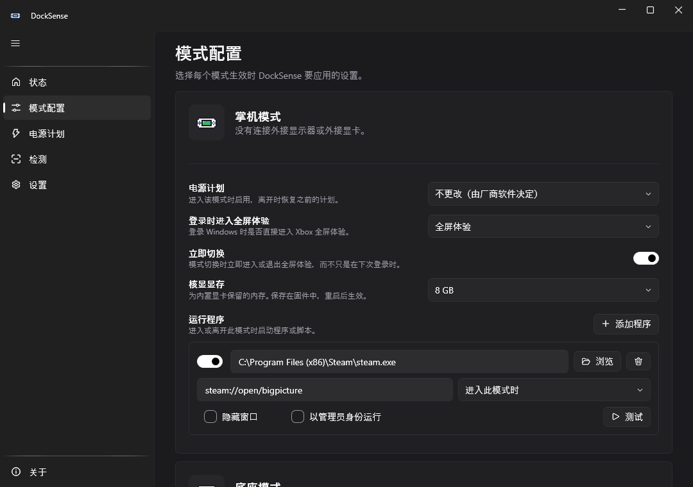
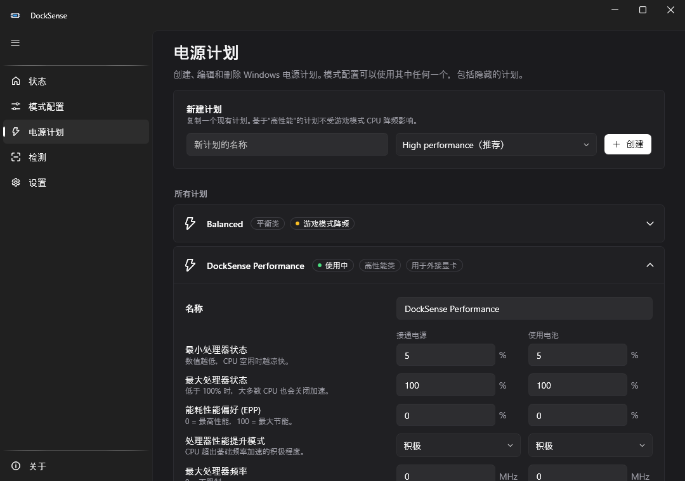
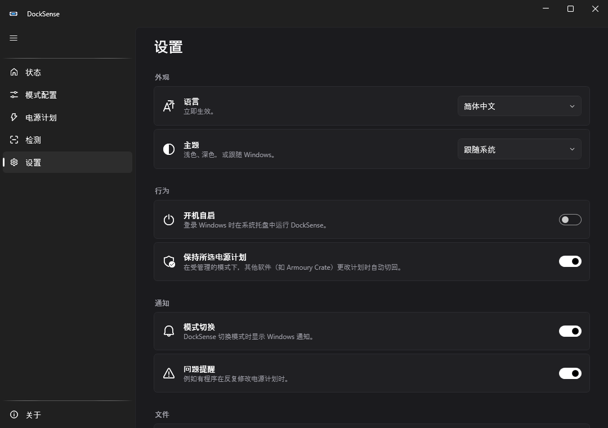
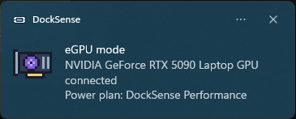

<div align="center">


# DockSense

**为 Windows 掌机自动切换电源配置：掌机 / 底座 / 外接显卡。**

[](https://github.com/rozx/DockSense/actions/workflows/ci.yml)
[](https://github.com/rozx/DockSense/releases)
[](https://github.com/rozx/DockSense/releases)
[](LICENSE)
[](#系统要求)
[](https://dotnet.microsoft.com/)
[](https://github.com/rozx/DockSense/stargazers)

[English](README.md) · **简体中文**



</div>

---

DockSense 运行在系统托盘里。它会监测外接显卡、外接显示器和电源的变化，判断掌机当前的使用方式，然后自动切换到对应的**电源计划**和 **Xbox 全屏体验**，设置**核显显存**，并启动**你指定的程序**。插拔底座时，你不需要手动切换任何东西。

这个项目源于一次问题排查：ASUS ROG Xbox Ally X 接上 RTX 5090 显卡坞后，游戏只有 50 帧左右，CPU 被压到了 **2 GHz / 12W**，而且只在游戏处于前台时才会这样。

## 目录

- [为什么需要 DockSense](#为什么需要-docksense)
- [功能](#功能)
- [工作原理](#工作原理)
- [截图](#截图)
- [安装](#安装)
- [使用](#使用)
- [配置](#配置)
- [支持的硬件](#支持的硬件)
- [常见问题](#常见问题)
- [从源码编译](#从源码编译)
- [路线图](#路线图)
- [参与贡献](#参与贡献)
- [致谢](#致谢)
- [许可证](#许可证)

## 为什么需要 DockSense

Windows **游戏模式**里有一套隐藏的处理器电源配置 `GameMode`，会在游戏处于前台时生效。在 AMD 掌机上，厂商的预配置包把它设置成了：

| 设置 | 平时 | 游戏在前台时 |
|---|---|---|
| 能效偏好（EPP） | 20（偏性能） | **100（最省电）** |
| 线程调度 | 优先大核 | **优先小核** |

纯掌机游玩时，CPU 和核显分享同一份很小的功耗预算，这样设置是合理的。但接了**外接显卡**以后，CPU 才是瓶颈，昂贵的显卡有一半时间都在等 CPU。下面是 ROG Xbox Ally X + RTX 5090 的实测数据，游戏模式开启、游戏在前台：

| 当前电源计划 | CPU 功耗 | CPU 频率 | 结果 |
|---|---|---|---|
| 厂商的 "Turbo" 计划（平衡类型） | 10–15W | 2.2–2.6 GHz | 被降频 |
| **DockSense Performance**（高性能类型） | **29–45W** | **4.0–4.4 GHz** | 满速 |

这些覆盖参数只写给了"平衡"类型的电源计划，而且 `powercfg` 看不到它们。DockSense 会在接上外接显卡时，切换到一个基于"高性能"的计划；拔掉显卡坞后，再把控制权交还给厂商软件。游戏模式可以一直开着。

📖 完整的分析过程、原始数据和注册表路径见 **[docs/game-mode-throttle.md](docs/game-mode-throttle.md)**（英文）。

## 功能

- 🔌 **自动识别模式**：掌机、底座（外接显示器）或外接显卡（雷电 / USB4 / OCuLink），并带防抖，插拔底座时不会来回跳。
- ⚡ **每个模式使用不同的电源计划**：离开该模式时恢复之前的计划，还会自动创建一个不受游戏模式降频影响的"外接显卡专用"计划。
- 🛡️ **保持你选的计划**：厂商软件（如 Armoury Crate）把计划切回去时会自动改回；如果有程序一直在抢，DockSense 会主动退让。
- 🛠️ **电源计划编辑器**：以任意已有计划为基础新建计划；分别为接通电源和使用电池时修改掌机上最常用的设置（处理器状态、EPP、加速模式、最大频率、核心偏好、关闭显示器和睡眠时间）；还可以重命名或删除计划。被隐藏的"高性能"类型计划也会列出来。
- 🎮 **每个模式单独设置 Xbox 全屏体验**：比如掌机时使用全屏体验，接底座时使用桌面。模式切换时 DockSense 可以**立即切换**，而不只是在下次登录时生效。
- 🚀 **模式切换时运行程序**：在进入或离开某个模式时（或 DockSense 在该模式下启动时）启动程序、脚本或网址，可以带参数、隐藏窗口或以管理员身份运行。
- 🧠 **每个模式单独设置核显显存**（ROG Xbox Ally X 等 ASUS 掌机）：比如掌机时给核显 8 GB，接外接显卡时设为最小，把内存还给游戏。固件会在下次重启时应用，需要重启时 DockSense 会提醒你。
- 🔔 **Windows 原生通知**：模式切换时提醒你，显示识别到的显卡和应用的电源计划。
- 🩺 **诊断功能**：状态页会显示游戏模式降频是否影响当前计划；一键生成报告，列出显卡、显示器、电源计划和隐藏的覆盖参数。
- 🌐 **中英双语**，支持浅色和深色主题，每种状态都有像素风托盘图标。
- 🪶 **不需要管理员权限，不装驱动，不装服务**：使用公开文档化的 Windows API；可选的核显显存设置使用 ASUS ACPI 接口（与 Armoury Crate 相同）。

## 工作原理



| 模式 | 判断条件 | 默认配置 |
|:---:|---|---|
| <br/>**外接显卡** | 有一块被 Windows 标记为可热插拔、或不属于本机的 PCIe 显卡（雷电 / USB4 显卡坞）。OCuLink 显卡坞可以手动指定。 | DockSense Performance 计划 · 开机进入桌面 |
| <br/>**底座** | 有正在使用的外接显示器，且没有外接显卡 | 不改电源计划 · 开机进入桌面 |
| <br/>**掌机** | 以上都不满足 | 不改电源计划（由厂商决定） · 开机进入全屏体验 |

几个细节：

- **不靠厂商 ID 判断**：AMD 核显和 AMD 外接显卡的厂商 ID 是一样的。USB 显示适配器（DisplayLink）和虚拟显示器（串流软件创建的）会被忽略。
- **拔线的过程很乱**：断电比 Windows 移除显卡早大约 10 秒，厂商软件会在断电那一刻切换计划。DockSense 会一直保持外接显卡模式，直到显卡真正消失，然后恢复厂商软件选的那个计划。

## 截图

<table>
  <tr>
    <td width="50%"><p align="center"><b>模式配置</b>：每个模式的电源计划、全屏体验、核显显存和程序</p></td>
    <td width="50%"><p align="center"><b>电源计划</b>：新建、编辑和删除计划</p></td>
  </tr>
  <tr>
    <td><p align="center"><b>设置</b>：语言、主题、开机自启、通知</p></td>
    <td></td>
  </tr>
  <tr>
    <td><p align="center">模式切换时的<b>系统通知</b></p></td>
    <td align="center">
      &nbsp;
      &nbsp;
      &nbsp;
      
      <p><b>托盘图标</b>：掌机 · 底座 · 外接显卡 · 已暂停</p>
    </td>
  </tr>
</table>

## 安装

### 系统要求

- Windows 10 2004 或更新版本，或 Windows 11（x64 或 ARM64）
- 不需要另外安装 .NET：发布版自带运行时

### 下载

1. 从 **[最新版本](https://github.com/rozx/DockSense/releases/latest)** 下载 `DockSense-<版本>-win-x64.zip`。
2. 解压到任意位置（例如 `%LOCALAPPDATA%\Programs\DockSense`），运行 **DockSense.exe**。
3. 第一次运行会打开主窗口，之后会安静地在托盘里启动。在 **设置 → 开机自启** 里打开，登录 Windows 时就会自动运行。

> [!NOTE]
> 目前可执行文件还没有代码签名，第一次运行时 Windows SmartScreen 可能会拦截，点击 **更多信息 → 仍要运行** 即可。

## 使用

- **托盘图标**：左键打开主窗口；右键可以暂停自动切换、立即重新检测，或者退出。
- **状态**：当前模式、当前电源计划、游戏模式降频检测、识别到的显卡和显示器，以及最近的活动记录。
- **模式配置**：为每个模式选择：
  - 电源计划：*不更改*（由厂商软件决定）、*DockSense Performance*（外接显卡专用计划），或任意一个 Windows 电源计划（包括隐藏的计划）
  - 登录时是否进入全屏体验，以及模式切换时是否**立即切换**
  - **核显显存**（支持的 ASUS 设备；重启后生效）
  - 进入或离开该模式时**要运行的程序**。点击**测试**可以立即启动。
- **电源计划**：以任意已有计划为基础新建计划（基于"高性能"的计划不受游戏模式降频影响），修改接通电源和使用电池时的设置，重命名或删除计划。
- **检测**：稳定等待时间、"仅在接通电源时识别为底座模式"，以及逐块显卡的手动指定（*始终 / 始终不视为外接显卡*）。

关闭窗口后 DockSense 仍在托盘中运行；再次运行 DockSense.exe 会重新打开窗口。

## 配置

设置保存在 `%APPDATA%\DockSense\config.json`，界面会帮你修改它。日志和运行状态保存在 `%LOCALAPPDATA%\DockSense`。

| 配置项 | 默认值 | 说明 |
|---|---|---|
| `handheld` / `docked` / `egpu` → `powerPlan.kind` | `Unmanaged` / `Unmanaged` / `DockSensePerformance` | `Unmanaged`、`DockSensePerformance` 或 `Specific`（配合 `planId`） |
| `handheld` / `docked` / `egpu` → `fse` | `FullScreenExperience` / `Desktop` / `Desktop` | `Unchanged`、`Desktop` 或 `FullScreenExperience`，下次登录时生效 |
| `handheld` / `docked` / `egpu` → `fseApplyImmediately` | `false` | 模式切换时也立即进入或退出全屏体验 |
| `handheld` / `docked` / `egpu` → `igpuMemoryMb` | `null` | 写入固件的核显显存大小，单位 MB（`0` = 自动，`null` = 不更改），重启后生效 |
| `handheld` / `docked` / `egpu` → `programs` | `[]` | 要启动的程序：`path`、`arguments`、`when`（`Enter`、`EnterOrStartup` 或 `Leave`）、`hidden`、`runAsAdministrator`、`enabled` |
| `detection.settleSeconds` | `5` | 新模式需要保持多久才会生效 |
| `detection.dockedRequiresAcPower` | `false` | 仅在接通电源时才把外接显示器计入底座模式 |
| `detection.forceEgpuInstanceIds` / `ignoreGpuInstanceIds` | `[]` | 逐块显卡的手动指定（PnP 实例 ID） |
| `reassertPowerPlan` | `true` | 在受管理的模式下，其他软件修改计划时自动切回 |
| `ui.language` | `system` | `system`、`en` 或 `zh-Hans` |
| `ui.theme` | `System` | `System`、`Light` 或 `Dark` |
| `ui.notifyOnModeChange` / `ui.notifyOnWarnings` | `true` | Windows 通知 |

## 支持的硬件

DockSense 只使用标准的 Windows API，理论上任何 Windows 掌机或笔记本都能用。目前已经实测过的：

| 设备 | 外接显卡 / 底座 | 状态 |
|---|---|---|
| ASUS ROG Xbox Ally X（Ryzen AI Z2 Extreme） | ASUS ROG XG Mobile（RTX 5090 Laptop GPU），USB4 | ✅ 已实测：实际拔插、与 Armoury Crate 共存 |

在其他设备上测试过？欢迎 [提交 issue](https://github.com/rozx/DockSense/issues/new)，并附上 **关于 → 复制诊断报告** 的内容，我们会把它加到这里。

## 常见问题

<details>
<summary><b>控制面板里找不到 "DockSense Performance" 计划？</b></summary>

在 Modern Standby（现代待机）设备上，Windows 会把"高性能"类型的计划从控制面板和 `powercfg /list` 里隐藏起来。计划本身存在而且正常工作。DockSense 的**电源计划**页面会列出所有计划，包括隐藏的；也可以用 `powercfg /getactivescheme` 查看，或者直接看状态页。
</details>

<details>
<summary><b>为什么核显显存需要重启？</b></summary>

为核显保留的内存（UMA 帧缓冲）由固件在开机时分配，和 Armoury Crate 里的设置一样。DockSense 会立即写入当前模式的大小，状态页随后显示"重启后生效"，并提供**立即重启**按钮。DockSense 永远不会自己重启，也只会写入固件本身提供的选项。如果拔掉外接显卡后不重启继续玩，旧的大小会一直保持到下次重启。大多数游戏两种情况下都能正常运行，因为 Windows 还会给核显分配共享内存。
</details>

<details>
<summary><b>立即切换全屏体验不起作用？</b></summary>

需要支持全屏体验的 Windows 版本（掌机上的 Windows 11，或开启了"Xbox 模式"），并且设置了主页应用（Xbox 应用，或 AnyFSE 等启动器）。如果 Windows 弹出确认，请选择不重启直接进入。如果 Windows 设置为进入时"重启以优化"，DockSense 不会立即切换，因为那会重启电脑；登录时的设置仍会在下次登录时生效。
</details>

<details>
<summary><b>DockSense 会和 Armoury Crate / Legion Space 等厂商软件冲突吗？</b></summary>

只在你选择了具体计划的模式下才会接管，而且有限度：如果有程序在 2 分钟内切换计划超过 5 次，DockSense 会停止自动切回，直到下次模式切换，并提醒你。厂商的 TDP 设置（例如 Armoury Crate 的 35W Turbo）和 Windows 电源计划是两回事，会照常生效。
</details>

<details>
<summary><b>需要关闭游戏模式吗？</b></summary>

不需要，那是以前的临时解决办法。接外接显卡时，DockSense 使用的计划不会被游戏模式的电源配置影响，所以游戏模式可以一直开着，纯掌机游玩时它还能继续发挥作用。
</details>

<details>
<summary><b>怎么彻底卸载？</b></summary>

1. 如果需要，在 **电源计划** 页面删除 DockSense Performance 计划（它不能是当前正在使用的计划，Windows 不允许删除正在使用的计划）。也可以用 `powercfg /delete <guid>`，GUID 就是 `config.json` 里的 `dockSensePerformancePlanId`。
2. 关闭 **开机自启**，然后从托盘退出。
3. 删除 DockSense 所在的文件夹，以及 `%APPDATA%\DockSense` 和 `%LOCALAPPDATA%\DockSense`。
</details>

<details>
<summary><b>切换不符合预期，怎么排查？</b></summary>

打开 **设置 → 打开日志**，每一次判断都会连同当时的硬件状态一起记录下来。运行 `DockSense.exe --probe report.txt` 可以生成一份只读的诊断报告。
</details>

## 从源码编译

需要 Windows 和 [.NET 10 SDK](https://dotnet.microsoft.com/download)。

```powershell
git clone https://github.com/rozx/DockSense.git
cd DockSense
dotnet build
dotnet test
dotnet run --project src/DockSense.App
```

| 项目 | 用途 |
|---|---|
| `src/DockSense.Core` | 与平台无关的逻辑：模式判断、防抖、电源计划策略、程序触发、电源设置目录、核显显存解码、配置（全部有单元测试） |
| `src/DockSense.App` | WPF 托盘程序：Windows API（SetupAPI、显示配置、powrprof、gaming experience）、ASUS ACPI、界面、通知 |
| `tests/DockSense.Core.Tests` | xUnit 测试，包括实测的 Ally X / XG Mobile 拔线过程 |
| `tools/DockSense.IconGen` | 从 `Sprites.cs` 里的像素画生成所有图标 |

图标是用文本画出来的。要修改图标，编辑 `tools/DockSense.IconGen/Sprites.cs`，然后运行 `dotnet run --project tools/DockSense.IconGen -- assets`。

### 发布流程

发布是自动的，但必须**同时满足三个条件**：

1. 一个合并到 `main` 的 PR **已经合并**。
2. 这个 PR 的分支名是 **`release/v<主版本>.<次版本>`** 或 `release/v<主版本>.<次版本>.<修订号>`，例如 `release/v0.2`、`release/v1.2.3`。
3. 这个 PR 带有 **`release`** 标签。

满足条件后，GitHub Actions 会从分支名读取版本号，运行测试，编译 x64 和 ARM64 的单文件程序（自带运行时），给合并提交打上 `v<版本号>` 标签，并发布附带自动生成更新说明的 Release。其他推送和 PR 只会运行 CI（编译 + 测试）。

## 路线图

- [x] 模式切换时实时进入或退出全屏体验，而不只是在登录时生效（v0.2）
- [x] 电源计划编辑器（v0.2）
- [x] 模式切换时运行程序（v0.2）
- [x] ASUS 掌机上每个模式单独设置核显显存（v0.2）
- [ ] 通过厂商接口为每个模式设置 TDP（ASUS、Lenovo 等）
- [ ] 其他厂商掌机的核显显存设置
- [ ] 按游戏单独配置
- [ ] 通过 winget / Microsoft Store 分发
- [ ] 代码签名

欢迎在 [Issues](https://github.com/rozx/DockSense/issues) 里提建议、投票。

## 参与贡献

欢迎提交问题反馈、设备测试报告和 PR。

- 硬件相关的问题，请附上诊断报告（**关于 → 复制诊断报告**）。
- `DockSense.Core` 里不要引入 Windows API；新增的判断逻辑请补上测试。
- 界面文字在 `src/DockSense.App/Localization/Strings*.resx` 中，请同时更新英文和中文。

## 致谢

- [WPF-UI](https://github.com/lepoco/wpfui)：WPF 的 Fluent 控件库
- [H.NotifyIcon](https://github.com/HavenDV/H.NotifyIcon)：托盘图标
- [CommunityToolkit.Mvvm](https://github.com/CommunityToolkit/dotnet) 和 [Windows Community Toolkit](https://github.com/CommunityToolkit/WindowsCommunityToolkit) 的通知组件
- 像素图标使用了 GrafxKid 的 [Sweetie 16](https://lospec.com/palette-list/sweetie-16) 调色板

## 许可证

DockSense 是自由软件，以 [GNU 通用公共许可证 v3.0](LICENSE) 协议发布。
Copyright © 2026 [rozx](https://github.com/rozx)。
