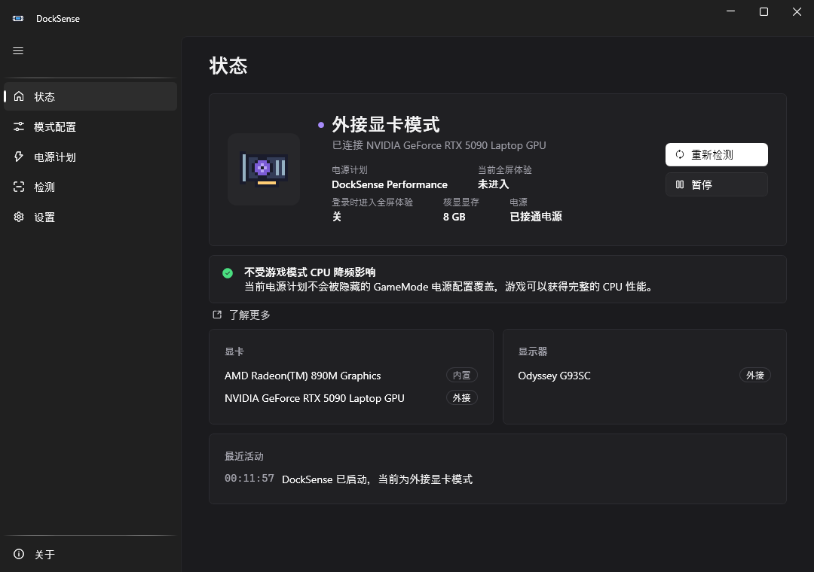
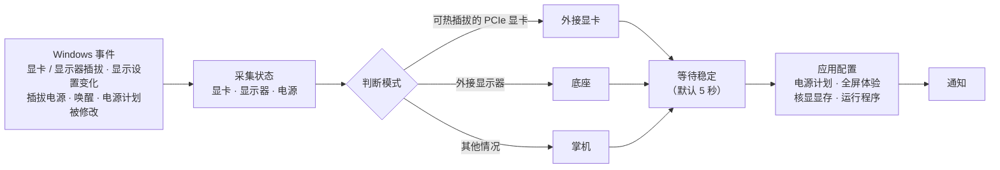
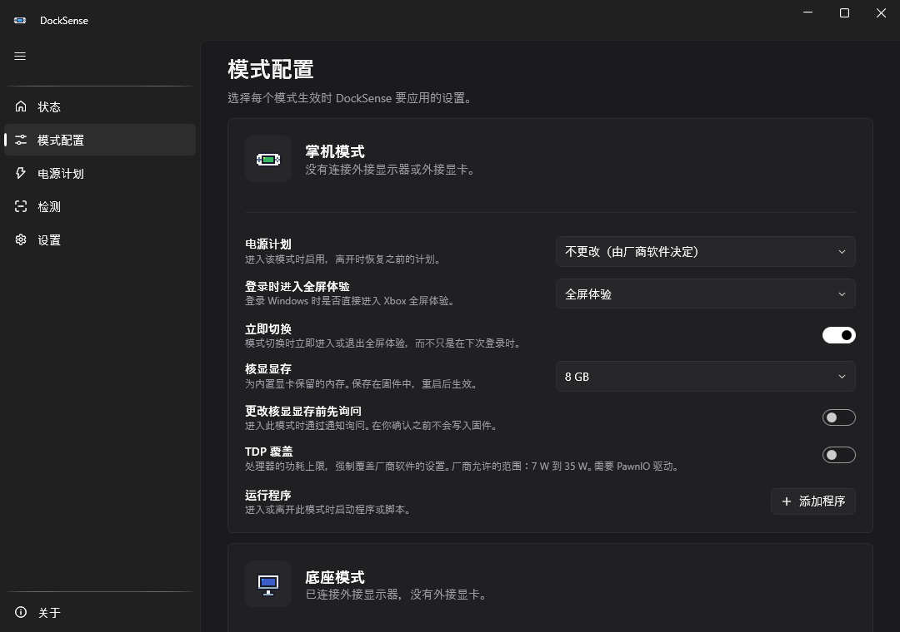
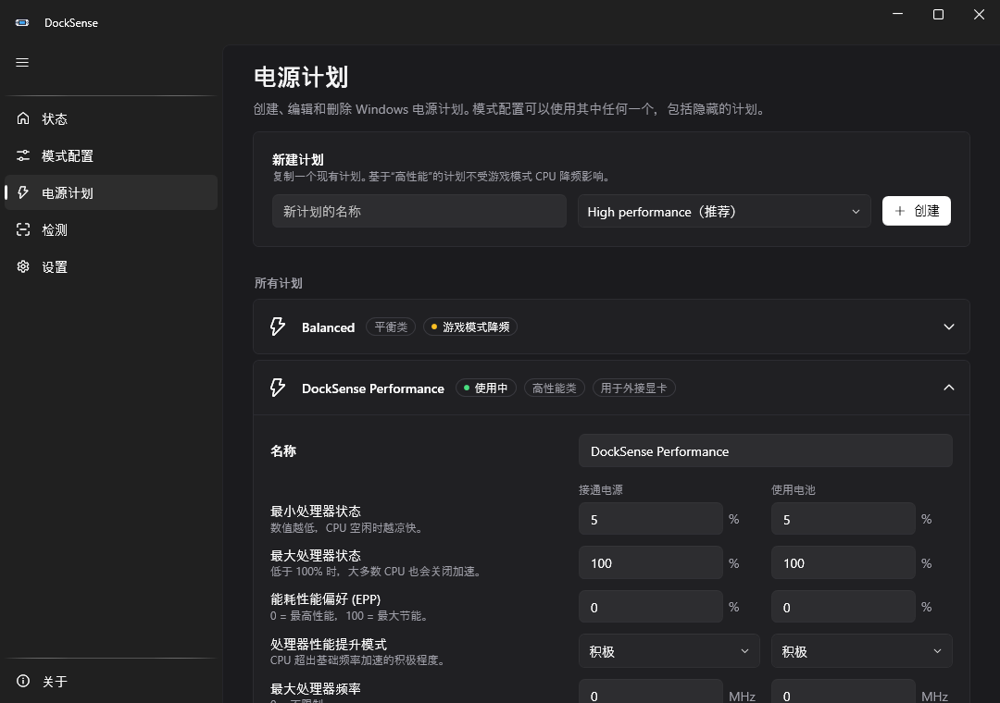
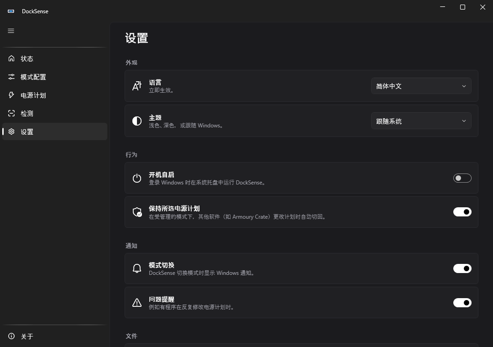
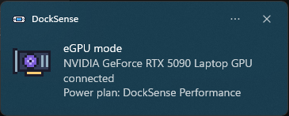

<div align="center">


# DockSense

**Windows 掌机的模式自动切换工具：掌机 / 底座 / 外接显卡。**

每个模式都有自己的电源计划、Xbox 全屏体验、核显显存和启动程序，插拔底座或显卡坞时立即自动切换。

[](https://github.com/rozx/DockSense/actions/workflows/ci.yml)
[](https://github.com/rozx/DockSense/releases)
[](https://github.com/rozx/DockSense/releases)
[](LICENSE)
[](#系统要求)
[](https://github.com/rozx/DockSense/stargazers)

[English](README.md) · **简体中文**

[⬇️ 下载最新版本](https://github.com/rozx/DockSense/releases/latest) · [功能](#功能) · [工作原理](#工作原理) · [显卡坞降频修复](#外接显卡的游戏模式降频修复) · [常见问题](#常见问题)



</div>

---

DockSense 安静地运行在系统托盘里，实时监测外接显卡、外接显示器和电源变化，让你插拔底座或显卡坞时无需手动切换任何设置。它还能[修复接外接显卡后帧数低的问题](#外接显卡的游戏模式降频修复)——这个项目最初正是源于对这个问题的排查。

## 功能

### 每个模式可自动切换

- 🔌 **自动识别模式**：识别掌机、底座（外接显示器）或外接显卡（雷电 / USB4 / OCuLink），带防抖机制，插拔底座时不会来回跳。
- ⚡ **电源计划与内置编辑器**：为每个模式切换电源计划、离开时恢复原计划，并在厂商软件（如 Armoury Crate）改回时自动重设（带退让保护）；自带不受游戏模式降频影响的 **DockSense Performance** 计划，并可编辑接通电源/电池设置（包括隐藏的高性能计划）。
- 🎮 **Xbox 全屏体验**：按模式设置登录行为，还支持在模式切换时**立即切换**，无需等到下次登录。
- 🧠 **核显显存** *（ROG Xbox Ally X 等 ASUS 掌机；其他 AMD 掌机为实验性支持）*：按模式写入固件 UMA 帧缓冲大小——例如掌机给 8 GB、接外接显卡设最小以归还内存；托盘菜单提供**重启到`<模式>`**，一次重启即可生效。
- 🔥 **TDP 覆盖** *（ROG Ally 系列；需要 [PawnIO](https://pawnio.eu/) 驱动）*：按模式强制设定处理器功耗上限，覆盖 Armoury Crate 的设置——例如掌机 15 W、接外接显卡时全功率；厂商软件把它改回去时会重新写入，离开模式时交还控制权。超出厂商上限的数值会有明确警告。
- 🚀 **模式切换时运行程序**：在进入、离开某模式或在该模式启动时运行程序、脚本或网址，支持参数、隐藏窗口和管理员权限。

### 省心与可靠

- ⏱️ **登录后立即启动**：通过每用户登录计划任务在登录后约两秒启动（早于 Windows 常规自启动项，开机直入 Xbox 全屏体验时同样有效），即使在关机期间插拔了底座，开机也能立即就位。
- 🔔 **原生通知与 🩺 诊断**：模式切换与程序启动原生通知、状态页实时检测游戏模式降频，以及一键导出诊断报告。
- ⬆️ **自动更新**：每日检查 GitHub 发布页并校验 SHA-256，支持一键安装或下次启动自动安装（可关闭）。
- 🌐 **中英双语**、浅色/深色主题，以及覆盖每种状态的像素风托盘图标。
- 🪶 **轻量免安装**：无需管理员权限、不装驱动、不装后台服务，只用公开 Windows API，可选的核显显存功能使用 ASUS ACPI 接口。*（其他掌机上的实验性 AMD 驱动方式使用 AMD 自带的 API，是否需要管理员权限尚不清楚。）**（仅在 Program Files 等受保护目录更新时需要一次 UAC 确认。）**（可选的 TDP 覆盖是唯一的例外：它使用 PawnIO 驱动，并需要一次管理员批准。）*

## 工作原理



| 模式 | 判断条件 | 默认配置 |
|:---:|---|---|
| <br/>**外接显卡** | 有一块被 Windows 标记为可热插拔、或不属于本机的 PCIe 显卡（雷电 / USB4 显卡坞）。OCuLink 显卡坞可以手动指定。 | DockSense Performance 计划 · 开机进入桌面 |
| <br/>**底座** | 有正在使用的外接显示器，且没有外接显卡 | 不改电源计划 · 开机进入桌面 |
| <br/>**掌机** | 以上都不满足 | 不改电源计划（由厂商决定） · 开机进入全屏体验 |

**典型配置示例：**

- **掌机**：保持厂商 TDP/电源计划 · Xbox 全屏体验 · 8 GB 核显显存
- **底座**：保持电源计划 · 切换到桌面 · 自动启动常用桌面工具或浏览器
- **外接显卡**：**DockSense Performance**（解除游戏模式 CPU 降频）· 桌面模式 · 最小核显显存（把内存还给游戏）

几个细节：

- **不靠厂商 ID 判断**：AMD 核显和 AMD 外接显卡的厂商 ID 是一样的。USB 显示适配器（DisplayLink）和虚拟显示器（串流软件创建的）会被忽略。
- **拔线的过程很乱**：断电比 Windows 移除显卡早大约 10 秒，厂商软件会在断电那一刻切换计划。DockSense 会一直保持外接显卡模式，直到显卡真正消失，然后恢复厂商软件选的那个计划。

## 外接显卡的游戏模式降频修复

DockSense 源于一次问题排查：ASUS ROG Xbox Ally X 接上 RTX 5090 显卡坞后，游戏只有 50 帧左右，CPU 被压到了 **2 GHz / 12 W**，而且只在游戏处于前台时才会这样。如果你的掌机接上外接显卡后也是这样，那就是同一个问题：

- 游戏帧数低或卡顿，显卡占用率却远没有跑满。
- 任务管理器显示 CPU 占用 100%，但功耗只有 10–15 W，频率在 2 GHz 左右。
- 切出游戏（Alt+Tab）后，CPU 频率立刻上去。
- Armoury Crate 显示 Turbo 模式 35 W，但游戏里 CPU 始终到不了这个功耗。

Windows **游戏模式**里有一套隐藏的处理器电源配置 `GameMode`，会在游戏处于前台时生效。在 AMD 掌机上，厂商的预配置包把它设置成了：

| 设置 | 平时 | 游戏在前台时 |
|---|---|---|
| 能效偏好（EPP） | 20（偏性能） | **100（最省电）** |
| 线程调度 | 优先大核 | **优先小核** |

纯掌机游玩时，CPU 和核显分享同一份很小的功耗预算，这样设置是合理的。但接了**外接显卡**以后，CPU 才是瓶颈，昂贵的显卡有一半时间都在等 CPU。下面是 ROG Xbox Ally X + RTX 5090 的实测数据，游戏模式开启、游戏在前台：

| 当前电源计划 | CPU 功耗 | CPU 频率 | 结果 |
|---|---|---|---|
| 厂商的 "Turbo" 计划（平衡类型） | 10–15 W | 2.2–2.6 GHz | 被降频 |
| **DockSense Performance**（高性能类型） | **29–45 W** | **4.0–4.4 GHz** | 满速 |

这些覆盖参数只写给了"平衡"类型的电源计划，而且 `powercfg` 看不到它们。DockSense 会在接上外接显卡时，切换到一个基于"高性能"的计划；拔掉显卡坞后，再把控制权交还给厂商软件。游戏模式可以一直开着。

📖 完整的分析过程、原始数据和注册表路径见 **[docs/game-mode-throttle.md](docs/game-mode-throttle.md)**（英文）。

## 截图

<table>
  <tr>
    <td width="50%"><p align="center"><b>模式配置</b>：每个模式的电源计划、全屏体验、核显显存和程序</p></td>
    <td width="50%"><p align="center"><b>电源计划</b>：新建、编辑和删除计划</p></td>
  </tr>
  <tr>
    <td><p align="center"><b>设置</b>：语言、主题、开机自启、通知</p></td>
    <td align="center">
      
      <p>模式切换时的<b>系统通知</b></p>
      <br />
      &nbsp;
      &nbsp;
      &nbsp;
      
      <p><b>托盘图标</b>：掌机 · 底座 · 外接显卡 · 已暂停</p>
    </td>
  </tr>
</table>

## 安装

### 系统要求

- Windows 10 2004 或更新版本，或 Windows 11（x64 或 ARM64）
- 不需要另外安装 .NET：发布版自带运行时

### 下载

1. 从 **[最新版本](https://github.com/rozx/DockSense/releases/latest)** 下载 `DockSense-<版本>-win-x64.zip`（ARM64 请下载 `win-arm64.zip`）。
2. 解压到任意位置（例如 `%LOCALAPPDATA%\Programs\DockSense`），运行 **DockSense.exe**。
3. 第一次运行会打开主窗口，之后会安静地在托盘里启动。在 **设置 → 开机自启** 里打开，登录 Windows 时就会自动运行。DockSense 会为你的账户注册一个登录时运行的计划任务，在登录后立即启动，而不用等 Windows 启动其他自启动程序。开机直接进入 Xbox 全屏体验时也会运行（Windows 默认会把自启动程序推迟到第一次切换到桌面之后）。
4. 从 0.3 版本开始，有新版本时 DockSense 会提醒你，并可以替你安装（**设置 → 更新**）。如果是从 0.2.1 或更早的版本升级，这一次需要手动替换 `DockSense.exe`。

> [!NOTE]
> 目前可执行文件还没有代码签名，第一次运行时 Windows SmartScreen 可能会拦截，点击 **更多信息 → 仍要运行** 即可。

## 使用

- **托盘图标**：左键打开主窗口；右键可以暂停自动切换、立即重新检测，或者退出。
- **状态**：当前模式、当前电源计划、游戏模式降频检测、识别到的显卡和显示器，以及最近的活动记录。
- **模式配置**：为每个模式选择：
  - 电源计划：*不更改*（由厂商软件决定）、*DockSense Performance*（外接显卡专用计划），或任意一个 Windows 电源计划（包括隐藏的计划）
  - 登录时是否进入全屏体验，以及进入该模式时是否**立即切换**。例如掌机模式设为全屏体验、底座模式设为桌面，并且都开启立即切换后，接上底座就会退出全屏体验，拔下后又会重新进入。
  - **核显显存**（支持的 ASUS 设备，以及通过 AMD 显卡驱动实验性支持的其他 AMD 设备；重启后生效），以及 DockSense 是否在**更改前先询问**
  - **TDP 覆盖**（装有 PawnIO 驱动的 ROG Ally 系列）：打开开关后拖动滑块或直接输入瓦数；关闭时 TDP 仍由厂商软件决定
  - 进入或离开该模式时**要运行的程序**。点击**测试**可以立即启动。
- **电源计划**：以任意已有计划为基础新建计划（基于"高性能"的计划不受游戏模式降频影响），修改接通电源和使用电池时的设置，重命名或删除计划。
- **检测**：稳定等待时间、"仅在接通电源时识别为底座模式"，以及逐块显卡的手动指定（*始终 / 始终不视为外接显卡*）。

关闭窗口后 DockSense 仍在托盘中运行；再次运行 DockSense.exe 会重新打开窗口。

## 配置

设置保存在 `%APPDATA%\DockSense\config.json`，界面会帮你修改它。日志和运行状态保存在 `%LOCALAPPDATA%\DockSense`。

<details>
<summary><b>查看全部 config.json 配置项与默认值</b></summary>

| 配置项 | 默认值 | 说明 |
|---|---|---|
| `handheld` / `docked` / `egpu` → `powerPlan.kind` | `Unmanaged` / `Unmanaged` / `DockSensePerformance` | `Unmanaged`、`DockSensePerformance` 或 `Specific`（配合 `planId`） |
| `handheld` / `docked` / `egpu` → `fse` | `FullScreenExperience` / `Desktop` / `Desktop` | `Unchanged`、`Desktop` 或 `FullScreenExperience`，下次登录时生效 |
| `handheld` / `docked` / `egpu` → `fseApplyImmediately` | `false` | 模式切换时也立即进入或退出全屏体验 |
| `handheld` / `docked` / `egpu` → `igpuMemoryMb` | `null` | 写入固件的核显显存大小，单位 MB（`0` = 自动，`null` = 不更改），重启后生效 |
| `handheld` / `docked` / `egpu` → `igpuMemoryApply` | `Automatic` | `Automatic`：进入该模式时立即写入。`Ask`：先通过通知询问，在你确认之前不会写入 |
| `handheld` / `docked` / `egpu` → `tdpWatts` | `null` | 该模式下强制设定的处理器功耗上限，单位瓦（`null` = 不更改）。仅限支持的设备；超出设备范围的数值不会写入 |
| `tdpConfirmedBoard` / `tdpConfirmedWatts` | `null` / `0` | 当你同意使用超出厂商上限的 TDP 时由 DockSense 写入：确认时的设备型号和确认过的最高数值，对所有模式配置有效。更高的数值，或者换到另一型号上的任何超限数值，在“模式配置”中确认之前不会写入。复制到同一型号的另一台设备时，这份确认会一并带过去 |
| `handheld` / `docked` / `egpu` → `programs` | `[]` | 要启动的程序：`path`、`arguments`、`when`（`Enter`、`EnterOrStartup` 或 `Leave`）、`hidden`、`runAsAdministrator`、`enabled` |
| `detection.settleSeconds` | `5` | 新模式需要保持多久才会生效 |
| `detection.dockedRequiresAcPower` | `false` | 仅在接通电源时才把外接显示器计入底座模式 |
| `detection.forceEgpuInstanceIds` / `ignoreGpuInstanceIds` | `[]` | 逐块显卡的手动指定（PnP 实例 ID） |
| `reassertPowerPlan` | `true` | 在受管理的模式下，其他软件修改计划时自动切回 |
| `updates` | `Notify` | `Off`（从不检查）、`Notify`（每天检查一次并提醒你）或 `Automatic`（同时下载，并在 DockSense 下次启动时安装） |
| `ui.language` | `system` | `system`、`en` 或 `zh-Hans` |
| `ui.theme` | `System` | `System`、`Light` 或 `Dark` |
| `ui.notifyOnStartup` / `ui.notifyOnModeChange` / `ui.notifyOnProgramStart` / `ui.notifyOnWarnings` | `true` | Windows 通知：手动启动 DockSense（登录时自动启动不通知）、模式切换、模式配置启动程序、出现问题 |

</details>

## 支持的硬件

所有核心功能——模式识别、电源计划、游戏模式外接显卡降频修复、Xbox 全屏体验以及启动程序——均基于标准 Windows API，适用于所有 Windows 掌机（如 ROG Ally / Ally X、Legion Go、MSI Claw、Ayaneo、GPD、OneXPlayer）和笔记本。有两项可选设置取决于设备。**核显显存**：

- **ASUS** 掌机：通过 `ATKACPI` 固件接口，已实测。
- Radeon 驱动提供 *Variable Graphics Memory* 的**其他 AMD 掌机**（例如 MSI Claw A8）：通过 AMD 驱动设置。🧪 **实验性功能**：按照 AMD 的 SDK 编写，尚未在这类设备上实际运行过。驱动可能在保存后立即重启电脑，因此 DockSense 总是先询问，并且只提供“更改并重启”。如果你试用了，欢迎[反馈结果](https://github.com/rozx/DockSense/issues)（无论成功还是遇到问题），并附上诊断报告。

**TDP 覆盖**支持 ROG Ally 系列（ROG Ally、ROG Ally X、ROG Xbox Ally X），因为 DockSense 知道它们的功耗范围。目前只在 ROG Xbox Ally X 上实测过，其他型号使用同样的方法，尚未测试。

目前已经实测过的设备：

| 设备 | 外接显卡 / 底座 | 状态 |
|---|---|---|
| ASUS ROG Xbox Ally X（Ryzen AI Z2 Extreme） | ASUS ROG XG Mobile（RTX 5090 Laptop GPU），USB4 | ✅ 已实测：实际拔插、与 Armoury Crate 共存 |

在其他设备上测试过？欢迎 [提交 issue](https://github.com/rozx/DockSense/issues/new)，并附上 **关于 → 复制诊断报告** 的内容，我们会把它加到这里。

## 常见问题

<details>
<summary><b>控制面板里找不到 "DockSense Performance" 计划？</b></summary>

在 Modern Standby（现代待机）设备上，Windows 会把"高性能"类型的计划从控制面板和 `powercfg /list` 里隐藏起来。计划本身存在而且正常工作。DockSense 的**电源计划**页面会列出所有计划，包括隐藏的；也可以用 `powercfg /getactivescheme` 查看，或者直接看状态页。
</details>

<details>
<summary><b>为什么核显显存需要重启？</b></summary>

为核显保留的内存（UMA 帧缓冲）由固件在开机时分配，和 Armoury Crate 里的设置一样。DockSense 会立即写入当前模式的大小，状态页随后显示"重启后生效"，并提供**立即重启**按钮，通知上也有同样的按钮。DockSense 永远不会自己重启，也只会写入固件本身提供的选项。如果拔掉外接显卡后不重启继续玩，旧的大小会一直保持到下次重启。大多数游戏两种情况下都能正常运行，因为 Windows 还会给核显分配共享内存。

如果不想"先拔线、等检测、再重启"，可以在切换之前使用托盘菜单：**重启到掌机模式（8 GB）**（菜单项会显示目标模式和大小）在你确认后写入该模式的大小并重启 Windows。在重启过程中插上或拔下底座 / 外接显卡，开机后显存就已经是正确的大小。只有当其他模式的大小与当前生效的大小不同时，才会出现这个菜单项。

如果想每次自己决定，可以在模式配置里打开**更改核显显存前先询问**。进入该模式时会先弹出通知，提供**更改**和**更改并重启**两个按钮。在你选择之前不会写入固件；如果错过了通知，状态页上仍会保留这个询问。

在没有 ASUS 接口的设备上，如果 AMD 显卡驱动提供 Variable Graphics Memory，DockSense 会通过驱动设置大小。这是**实验性功能**：驱动可能在保存后自行重启电脑，因此每次更改都会先询问，并且只提供**更改并重启**。欢迎[在 GitHub 上反馈问题](https://github.com/rozx/DockSense/issues)。

有些电脑连接着外接显卡时无法启动。这种情况下，请在未连接外接显卡时使用**重启到外接显卡模式**，登录后再接上。重启后的几分钟内 DockSense 会保留外接显卡模式的大小，而不是把掌机模式的大小写回去。
</details>

<details>
<summary><b>TDP 覆盖是怎么工作的？安全吗？</b></summary>

每个模式都可以强制设定自己的处理器功耗上限（TDP），不管 Armoury Crate 设成什么：例如掌机模式设 15 W 以延长续航，接外接显卡时关闭开关。

- **需要什么**：[PawnIO](https://pawnio.eu/) 驱动（需要你自己安装，DockSense 不附带也不安装任何驱动）、管理员帐户，并且 DockSense 要安装在 Program Files 下它自己的文件夹中。请在管理员批准下把它复制过去（要复制而不是移动，这样文件才会获得该文件夹的权限），从托盘退出旧的那一份，再启动新的。如果之前开启了**开机自启**，请在新的那一份里重新开启（**设置 → 开机自启**）：登录启动项仍然指向旧的那一份。
- **为什么需要驱动**：在 ROG Xbox Ally X 上，固件会接受通过 ASUS 自家接口写入的功耗上限，然后直接无视。所以 DockSense 把上限直接发给处理器，做法和 RyzenAdj、Universal x86 Tuning Utility、G-Helper、Handheld Companion 一样，而这需要驱动。PawnIO 带有签名，并且只运行其作者签名的模块；DockSense 内置的是 PawnIO 项目原样的 AMD 模块。
- **为什么需要管理员批准**：PawnIO 只接受管理员调用。第一次选择数值时，Windows 会询问一次，然后 DockSense 注册一个以管理员权限设置 TDP 的任务（任务计划程序中的 `DockSense-TDP-<你的用户 ID>`）；DockSense 本身仍以普通权限运行。这个任务只接受一个瓦数，并且自己按设备范围检查。文件夹的要求也来自这里：任务运行的是 `DockSense.exe`，如果它所在的文件夹任何程序都能写入，这个文件就可能被替换。**设置 → TDP 辅助任务 → 移除**可以删掉这个任务。
- **写入的内容**：DockSense 为持续、中期和短时三个上限请求同一个数值。它是上限而不是目标：这些上限生效期间，空闲或负载较轻时处理器的功耗会更低；而如果厂商软件把它们改了回去，在 DockSense 重新写入之前（见*保持生效*）生效的是厂商的上限，这段时间功耗可能更高。范围从厂商规定的下限（Ally 系列为 7 W）到固件自身使用的最高短时上限（ROG Xbox Ally X 为 55 W，旧型号使用电池时更低）。
- **超出厂商上限**：数值超过厂商允许的范围（ROG Xbox Ally X 为 35 W）时，DockSense 会先询问，并在该设置下方保留一条警告。超出上限运行可能导致设备过热、电池损耗加快，甚至损坏硬件，而且可能不在保修范围内。风险由你自行承担。效果也可能有限：在 ROG Xbox Ally X 上设为 45 W 时，处理器以 44 W 运行了大约一分钟，变热（93 °C）后固件又把它拉回 35 W 并一直保持，和 Armoury Crate 的 Turbo 模式表现相同。其他设备的表现可能不同。
- **保持生效**：只要厂商软件发送性能模式，固件就会重新载入自己的上限；插拔充电器、从睡眠唤醒、在 Armoury Crate 里切换模式时都会发生。DockSense 不会读回这些上限，所以无论它们是否被改动，都会在这些情况发生几秒后重新写入自己的数值。如果确实被改动了，在写入成功之前生效的是厂商的上限。
- **交还控制权**：进入关闭了 TDP 覆盖的模式时，DockSense 会重新发送 Armoury Crate 当前选中的性能模式，固件随即恢复该模式自己的上限。只有 Silent、Performance 和 Turbo 可以这样重新发送。如果 Armoury Crate 处于其他模式（例如*手动*），DockSense 会在接通电源时发送 Turbo、使用电池时发送 Performance；要恢复你自己的数值，请在 Armoury Crate 中重新选择该模式。重启电脑也会清除所有上限。
</details>

<details>
<summary><b>立即切换全屏体验不起作用？</b></summary>

需要支持全屏体验的 Windows 版本（掌机上的 Windows 11，或开启了"Xbox 模式"），并且设置了主页应用（Xbox 应用，或 AnyFSE 等启动器）。如果 Windows 弹出确认，请选择不重启直接进入。如果 Windows 设置为进入时"重启以优化"，DockSense 不会立即切换，因为那会重启电脑；登录时的设置仍会在下次登录时生效。
</details>

<details>
<summary><b>DockSense 会和 Armoury Crate / Legion Space 等厂商软件冲突吗？</b></summary>

只在你选择了具体计划的模式下才会接管，而且有限度：如果有程序在 2 分钟内切换计划超过 5 次，DockSense 会停止自动切回，直到下次模式切换，并提醒你。厂商的 TDP 设置（例如 Armoury Crate 的 35 W Turbo）和 Windows 电源计划是两回事，会照常生效，除非你给该模式单独设置了 TDP 覆盖。
</details>

<details>
<summary><b>需要关闭游戏模式吗？</b></summary>

不需要，那是以前的临时解决办法。接外接显卡时，DockSense 使用的计划不会被游戏模式的电源配置影响，所以游戏模式可以一直开着，纯掌机游玩时它还能继续发挥作用。
</details>

<details>
<summary><b>"开机自启"已经打开，但 DockSense 没有启动。</b></summary>

打开 **设置**：开关显示的是登录时实际会发生的情况，下面的提示会说明是什么原因。

- **被 Windows 关闭了**：任务管理器和 Windows 设置 → 应用 → 启动 都可以禁用自启动程序，而 DockSense 并不知情。这时开关会显示为关闭，在 DockSense 里重新打开即可启用。
- **启动的是另一份**：如果你移动过 DockSense，自启动项仍然指向原来的位置。在想用的那一份里打开开关即可。
- **Windows 在等你进入桌面**：开机直接进入 Xbox 全屏体验时，Windows 会把自启动程序推迟到第一次切换到桌面之后，除非该程序被设为 *登录时启动*。DockSense 会为自己设置这一项；如果被改掉了，把开关关闭再打开即可。
- **启动了，但很晚**：正常情况下，DockSense 由任务计划程序里名为 `DockSense-<你的用户 ID>` 的任务在登录后约两秒启动。Windows 自己的自启动项只是后备，而 Windows 要在登录后半分钟到一分多钟才会运行它。如果这个任务不存在或被禁用，设置页会有提示；把开关关闭再打开即可重新注册。
</details>

<details>
<summary><b>接着底座开机，却还是进了全屏体验（或者反过来）。</b></summary>

Windows 只在外壳启动时决定一次是否进入全屏体验，依据的是 DockSense 为上一次所在模式保存的设置。DockSense 会抢在外壳之前启动，并按电脑现在所在的模式改正这项设置。如果 Windows 还是先读到了旧设置，只要该模式的配置开启了**立即切换**，DockSense 会在登录后约 20 秒切换过来。这需要打开 **开机自启**。

如果你已经知道接下来要用哪个模式，托盘菜单里的 **重启到掌机模式**（或底座、外接显卡）会在重启前先保存该模式的设置。
</details>

<details>
<summary><b>更新是怎么工作的？DockSense 会发送什么？</b></summary>

DockSense 每天向 GitHub 查询一次本仓库的最新版本（如果检查失败，比如没有联网，会在几小时后重试）。请求里除了用户代理中的 DockSense 版本号，不包含任何其他信息。可以在 **设置 → 更新** 里选择：

- **提醒我**（默认）：发送通知，并在状态页显示一张卡片。点击 **安装更新** 后，DockSense 会下载、校验并自行重新启动。当前模式和电源计划保持不变，模式配置里的程序也不会再次运行。
- **自动安装**：在后台下载，等 DockSense 下次启动时安装，所以不会在游戏中途重启。
- **不检查**：不发送任何请求。**立即检查** 仍然可用。

更新包只会从本仓库的发布页下载，大小和 SHA-256 必须与 GitHub 为该版本公布的一致。DockSense 只有一个文件：它先退出，下载好的新版本把旧的 `DockSense.exe` 改名为 `DockSense.exe.old`，自己放到原位置并启动。旧文件会在下次启动时删除。

如果 DockSense 放在你没有写入权限的文件夹里（比如 Program Files），Windows 会为替换文件这一步请求管理员确认，自动更新也会等你点击后再安装。获得确认的这一步在动任何文件之前，会自己再向 GitHub 核对一次更新包；这种情况下旧文件由 Windows 在下次重启电脑时删除。

目前的版本还没有代码签名，所以校验只能说明下载的文件与 GitHub 上的一致，不能说明是谁构建的。
</details>

<details>
<summary><b>怎么彻底卸载？</b></summary>

1. 如果需要，在 **电源计划** 页面删除 DockSense Performance 计划（它不能是当前正在使用的计划，Windows 不允许删除正在使用的计划）。也可以用 `powercfg /delete <guid>`，GUID 就是 `config.json` 里的 `dockSensePerformancePlanId`。
2. 关闭 **开机自启**（同时会删除登录计划任务）。如果用过 TDP 覆盖，请用 **设置 → TDP 辅助任务 → 移除** 删除辅助任务。然后从托盘退出。
3. 删除 DockSense 所在的文件夹，以及 `%APPDATA%\DockSense` 和 `%LOCALAPPDATA%\DockSense`。
</details>

<details>
<summary><b>切换不符合预期，怎么排查？</b></summary>

打开 **设置 → 打开日志**，每一次判断都会连同当时的硬件状态一起记录下来。运行 `DockSense.exe --probe report.txt` 可以生成一份只读的诊断报告：设备及其固件、每块显卡的连接方式、显示器、电源计划、检测到的厂商接口和厂商软件，以及你的 DockSense 设置。报告不包含用户名、计算机名，也不包含模式配置里要启动的程序。
</details>

## 从源码编译

需要 Windows 和 [.NET 10 SDK](https://dotnet.microsoft.com/download)。

```powershell
git clone https://github.com/rozx/DockSense.git
cd DockSense
dotnet build
dotnet test
dotnet run --project src/DockSense.App
```

| 项目 | 用途 |
|---|---|
| `src/DockSense.Core` | 与平台无关的逻辑：模式判断、防抖、电源计划策略、程序触发、电源设置目录、核显显存解码、配置（全部有单元测试） |
| `src/DockSense.App` | WPF 托盘程序：Windows API（SetupAPI、显示配置、powrprof、gaming experience）、ASUS ACPI、TDP 覆盖（PawnIO）、界面、通知 |
| `tests/DockSense.Core.Tests` | xUnit 测试，包括实测的 Ally X / XG Mobile 拔线过程 |
| `tools/DockSense.IconGen` | 从 `Sprites.cs` 里的像素画生成所有图标 |

图标是用文本画出来的。要修改图标，编辑 `tools/DockSense.IconGen/Sprites.cs`，然后运行 `dotnet run --project tools/DockSense.IconGen -- assets`。

<details>
<summary><b>发布流程（维护者）</b></summary>

发布是自动的，但必须**同时满足三个条件**：

1. 一个合并到 `main` 的 PR **已经合并**。
2. 这个 PR 的分支名是 **`release/v<主版本>.<次版本>`** 或 `release/v<主版本>.<次版本>.<修订号>`，例如 `release/v0.2`、`release/v1.2.3`。
3. 这个 PR 带有 **`release`** 标签。

满足条件后，GitHub Actions 会从分支名读取版本号，运行测试，编译 x64 和 ARM64 的单文件程序（自带运行时），给合并提交打上 `v<版本号>` 标签，并发布 Release。Release 说明取自 [CHANGELOG.md](CHANGELOG.md) 中该版本的章节，后面附上 GitHub 自动生成的已合并 PR 列表。如果发布 PR 的版本在 CHANGELOG 中没有对应章节，CI 会失败。其他推送和 PR 只会运行 CI（编译 + 测试）。

</details>

## 参与贡献

欢迎提交问题反馈、设备测试报告和 PR。如果 DockSense 对你有用，点个 ⭐ 能让更多掌机玩家找到它。

- 硬件相关的问题，请附上诊断报告（**关于 → 复制诊断报告**）。
- `DockSense.Core` 里不要引入 Windows API；新增的判断逻辑请补上测试。
- 界面文字在 `src/DockSense.App/Localization/Strings*.resx` 中，请同时更新英文和中文。

## 致谢

- [WPF-UI](https://github.com/lepoco/wpfui)：WPF 的 Fluent 控件库
- [H.NotifyIcon](https://github.com/HavenDV/H.NotifyIcon)：托盘图标
- [CommunityToolkit.Mvvm](https://github.com/CommunityToolkit/dotnet) 和 [Windows Community Toolkit](https://github.com/CommunityToolkit/WindowsCommunityToolkit) 的通知组件
- namazso 的 [PawnIO](https://pawnio.eu/) 及其[模块](https://github.com/namazso/PawnIO.Modules)（内置的 AMD SMU 模块未作修改，LGPL-2.1），用于 TDP 覆盖
- [RyzenAdj](https://github.com/FlyGoat/RyzenAdj)、[Universal x86 Tuning Utility](https://github.com/JamesCJ60/Universal-x86-Tuning-Utility) 和 [G-Helper](https://github.com/seerge/g-helper)：处理器功耗上限的设置方法；Linux 的 `asus-armoury` 驱动：Ally 系列的功耗范围
- 像素图标使用了 GrafxKid 的 [Sweetie 16](https://lospec.com/palette-list/sweetie-16) 调色板

## 许可证

DockSense 是自由软件，以 [GNU 通用公共许可证 v3.0](LICENSE) 协议发布。
Copyright © 2026 [rozx](https://github.com/rozx)。
